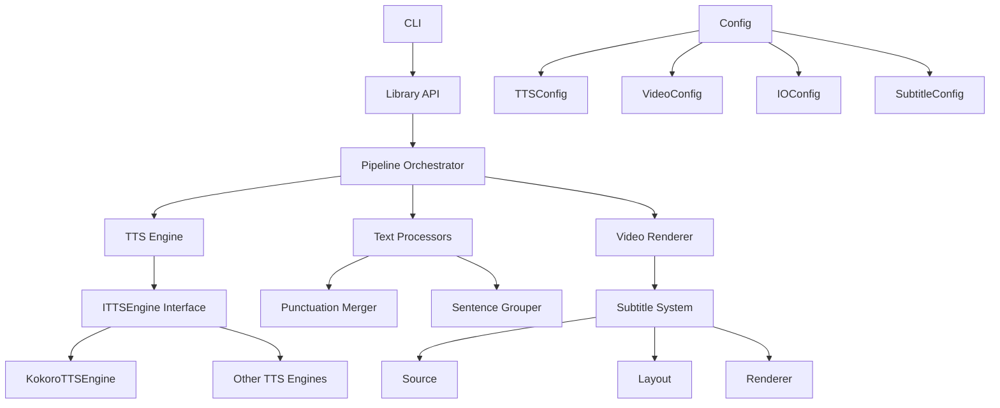
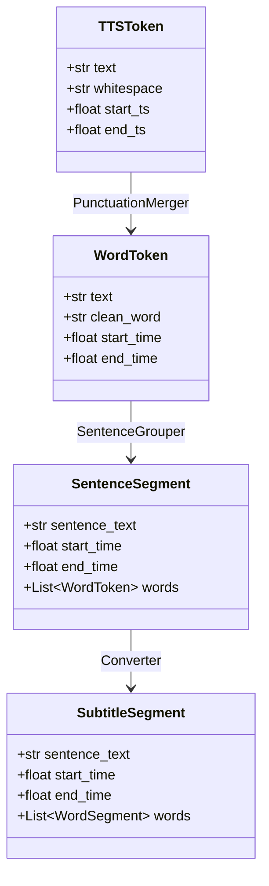

# Design Document: Codebase Refactoring

## Overview

This design describes a comprehensive refactoring of the KokoroMoviePy codebase to improve modularity, testability, and maintainability while preserving all existing functionality. The refactoring introduces proper abstractions for the TTS engine, separates text processing concerns, improves configuration management, and establishes a clear library-first API.

The refactoring follows the existing successful pattern established by the subtitle system (source → layout → renderer), extending this modular approach to the TTS pipeline and overall architecture.

## Architecture

### Current Architecture Issues

The current architecture has several pain points:

1. **Monolithic TTS Pipeline**: `MoviePySubtitleExtractor` class mixes TTS generation, punctuation merging, and sentence grouping in a single class with complex control flow
2. **Hard-coded Dependencies**: Kokoro TTS is directly instantiated, making it impossible to swap engines
3. **Config Dictionary Passing**: A single config dict is passed everywhere, making it unclear what configuration each component needs
4. **File Path Coupling**: Components accept file paths instead of abstractions, making testing difficult
5. **Limited Unit Testing**: Only integration tests exist; individual components cannot be tested in isolation

### Target Architecture

The refactored architecture will follow these principles:

1. **Layered Architecture**: Clear separation between TTS, processing, and rendering layers
2. **Dependency Injection**: Components depend on interfaces, not concrete implementations
3. **Single Responsibility**: Each class has one clear purpose
4. **Testable Components**: All components can be tested in isolation
5. **Library-First Design**: Clean API for programmatic usage, with CLI as a thin wrapper

### Architecture Diagram



## Components and Interfaces

### 1. TTS Engine Abstraction

#### ITTSEngine Interface

```python
from __future__ import annotations

from abc import ABC, abstractmethod
from dataclasses import dataclass
from typing import List
import numpy as np

@dataclass
class TTSToken:
    """Raw token from TTS engine with timing information."""
    text: str
    whitespace: str
    start_ts: float
    end_ts: float

@dataclass
class TTSResult:
    """Complete TTS generation result."""
    audio: np.ndarray
    sample_rate: int
    tokens: List[TTSToken]

class ITTSEngine(ABC):
    """Interface for text-to-speech engines."""
    
    @abstractmethod
    def generate(self, text: str) -> TTSResult:
        """
        Generate speech audio and word-level timing data from text.
        
        Args:
            text: Input text to synthesize
            
        Returns:
            TTSResult containing audio samples and token timing data
        """
        pass
```

#### KokoroTTSEngine Implementation

```python
from __future__ import annotations

import re
import numpy as np
from kokoro import KPipeline

from tts.interfaces import ITTSEngine, TTSResult, TTSToken
from tts.config import TTSConfig

class KokoroTTSEngine(ITTSEngine):
    """Kokoro TTS implementation."""
    
    def __init__(self, config: TTSConfig):
        self._config = config
        self._pipeline = KPipeline(lang_code=config.lang_code)
    
    def generate(self, text: str) -> TTSResult:
        """Generate speech using Kokoro TTS."""
        # Split into paragraphs
        paragraphs = re.split(r'\n+', text.strip())
        
        audio_segments = []
        all_tokens = []
        
        for paragraph in paragraphs:
            generator = self._pipeline(
                paragraph,
                voice=self._config.voice,
                speed=self._config.speed
            )
            
            paragraph_audio = []
            paragraph_tokens = []
            
            for result in generator:
                paragraph_audio.append(result.audio.cpu().numpy())
                paragraph_tokens.extend(result.tokens)
            
            # Calculate time offset for this paragraph
            time_offset = sum(len(seg) for seg in audio_segments) / 24000 if audio_segments else 0
            
            # Convert Kokoro tokens to our format with offset
            for token in paragraph_tokens:
                all_tokens.append(TTSToken(
                    text=token.text,
                    whitespace=token.whitespace,
                    start_ts=token.start_ts + time_offset,
                    end_ts=token.end_ts + time_offset
                ))
            
            if paragraph_audio:
                audio_segments.append(np.concatenate(paragraph_audio))
        
        # Concatenate all audio
        if audio_segments:
            audio = np.concatenate(audio_segments)
        else:
            audio = np.array([])
        
        return TTSResult(
            audio=audio,
            sample_rate=24000,
            tokens=all_tokens
        )
```

### 2. Text Processing Components

#### Punctuation Merger

```python
from __future__ import annotations

import re
from typing import List
from dataclasses import dataclass

@dataclass
class WordToken:
    """Processed word token with merged punctuation."""
    text: str
    clean_word: str
    start_time: float
    end_time: float

class PunctuationMerger:
    """Merges punctuation tokens into adjacent words."""
    
    def merge(self, tokens: List[TTSToken]) -> List[WordToken]:
        """
        Merge standalone punctuation into preceding words.
        
        Args:
            tokens: Raw TTS tokens
            
        Returns:
            List of word tokens with punctuation merged
        """
        merged_words = []
        
        for token in tokens:
            text_content = token.text.strip()
            is_punctuation = not bool(re.search(r'[a-zA-Z0-9]', text_content))
            
            if is_punctuation and merged_words:
                # Append to previous word
                merged_words[-1].text += token.text + token.whitespace
            else:
                # Valid word or first token
                merged_words.append(WordToken(
                    text=token.text + token.whitespace,
                    clean_word=text_content,
                    start_time=token.start_ts,
                    end_time=token.end_ts
                ))
        
        return merged_words
```

#### Sentence Grouper

```python
from __future__ import annotations

import re
from typing import List
from dataclasses import dataclass

@dataclass
class SentenceSegment:
    """Sentence with word-level timing."""
    sentence_text: str
    start_time: float
    end_time: float
    words: List[WordToken]

class SentenceGrouper:
    """Groups words into sentences based on punctuation and duration."""
    
    def __init__(self, max_duration: float = 5.0):
        self._max_duration = max_duration
    
    def group(self, words: List[WordToken]) -> List[SentenceSegment]:
        """
        Group words into sentence segments.
        
        Args:
            words: List of word tokens
            
        Returns:
            List of sentence segments
        """
        sentences = []
        
        if not words:
            return sentences
        
        current_sentence_words = []
        start_time = words[0].start_time
        
        for i, word in enumerate(words):
            current_sentence_words.append(word)
            current_end_time = word.end_time
            
            # Check end conditions
            is_sentence_end = re.search(r'[.!?](\s+)?$', word.text)
            is_duration_exceeded = (current_end_time - start_time) >= self._max_duration
            is_last_word = (i == len(words) - 1)
            
            if is_sentence_end or is_duration_exceeded or is_last_word:
                # Compile full sentence text
                full_text = "".join(w.text for w in current_sentence_words).strip()
                
                if full_text:
                    sentences.append(SentenceSegment(
                        sentence_text=full_text,
                        start_time=start_time,
                        end_time=current_end_time,
                        words=current_sentence_words
                    ))
                
                # Reset for next sentence
                current_sentence_words = []
                if not is_last_word:
                    start_time = words[i + 1].start_time
        
        return sentences
```

### 3. Configuration Classes

#### TTSConfig

```python
from __future__ import annotations

from dataclasses import dataclass

@dataclass
class TTSConfig:
    """Configuration for TTS engine."""
    lang_code: str = "a"
    voice: str = "af_heart"
    speed: float = 1.0
    
    @classmethod
    def from_dict(cls, config: dict) -> TTSConfig:
        """Create from legacy config dictionary."""
        return cls(
            lang_code=config.get("lang_code", "a"),
            voice=config.get("voice", "af_heart"),
            speed=config.get("speed", 1.0)
        )
```

#### VideoConfig

```python
from __future__ import annotations

from dataclasses import dataclass
from typing import Tuple

@dataclass
class VideoConfig:
    """Configuration for video rendering."""
    width: int = 1920
    height: int = 1080
    fps: int = 30
    bg_color: Tuple[int, int, int] = (0, 0, 0)
    
    @classmethod
    def from_dict(cls, config: dict) -> VideoConfig:
        """Create from legacy config dictionary."""
        return cls(
            width=config.get("width", 1920),
            height=config.get("height", 1080),
            fps=config.get("fps", 30),
            bg_color=config.get("bg_color", (0, 0, 0))
        )
```

#### IOConfig

```python
from __future__ import annotations

from dataclasses import dataclass
from pathlib import Path

@dataclass
class IOConfig:
    """Configuration for input/output paths."""
    input_text: Path
    output_dir: Path
    json_file: Path
    audio_file: Path
    srt_file: Path
    video_file: Path
    
    @classmethod
    def from_dict(cls, config: dict) -> IOConfig:
        """Create from legacy config dictionary."""
        run_dir = Path(config["run_dir"])
        return cls(
            input_text=Path(config["input_text"]),
            output_dir=run_dir,
            json_file=run_dir / "output_moviepy.json",
            audio_file=run_dir / "output_moviepy.wav",
            srt_file=run_dir / "output_moviepy_word.srt",
            video_file=run_dir / "output_video.mp4"
        )
```

### 4. I/O Abstractions

#### ITextReader Interface

```python
from __future__ import annotations

from abc import ABC, abstractmethod

class ITextReader(ABC):
    """Interface for reading input text."""
    
    @abstractmethod
    def read(self) -> str:
        """Read and return text content."""
        pass

class FileTextReader(ITextReader):
    """Reads text from a file."""
    
    def __init__(self, path: Path):
        self._path = path
    
    def read(self) -> str:
        with open(self._path, 'r', encoding='utf-8') as f:
            return f.read()

class StringTextReader(ITextReader):
    """Reads text from a string (for testing)."""
    
    def __init__(self, text: str):
        self._text = text
    
    def read(self) -> str:
        return self._text
```

#### IAudioWriter Interface

```python
from __future__ import annotations

from abc import ABC, abstractmethod
import numpy as np

class IAudioWriter(ABC):
    """Interface for writing audio data."""
    
    @abstractmethod
    def write(self, audio: np.ndarray, sample_rate: int) -> None:
        """Write audio data."""
        pass

class FileAudioWriter(IAudioWriter):
    """Writes audio to a WAV file."""
    
    def __init__(self, path: Path):
        self._path = path
    
    def write(self, audio: np.ndarray, sample_rate: int) -> None:
        import soundfile as sf
        sf.write(str(self._path), audio, sample_rate)

class InMemoryAudioWriter(IAudioWriter):
    """Stores audio in memory (for testing)."""
    
    def __init__(self):
        self.audio: np.ndarray | None = None
        self.sample_rate: int | None = None
    
    def write(self, audio: np.ndarray, sample_rate: int) -> None:
        self.audio = audio
        self.sample_rate = sample_rate
```

#### IMetadataWriter Interface

```python
from __future__ import annotations

from abc import ABC, abstractmethod
from typing import Any, List

class IMetadataWriter(ABC):
    """Interface for writing subtitle metadata."""
    
    @abstractmethod
    def write(self, segments: List[SentenceSegment]) -> None:
        """Write subtitle segments to storage."""
        pass

class JsonMetadataWriter(IMetadataWriter):
    """Writes subtitle metadata to JSON file."""
    
    def __init__(self, path: Path):
        self._path = path
    
    def write(self, segments: List[SentenceSegment]) -> None:
        import json
        
        data = []
        for seg in segments:
            data.append({
                "sentence_text": seg.sentence_text,
                "start_time": seg.start_time,
                "end_time": seg.end_time,
                "words": [
                    {
                        "text": w.text,
                        "clean_word": w.clean_word,
                        "start_time": w.start_time,
                        "end_time": w.end_time
                    }
                    for w in seg.words
                ]
            })
        
        with open(self._path, 'w', encoding='utf-8') as f:
            json.dump(data, f, indent=4, ensure_ascii=False)

class InMemoryMetadataWriter(IMetadataWriter):
    """Stores metadata in memory (for testing)."""
    
    def __init__(self):
        self.segments: List[SentenceSegment] = []
    
    def write(self, segments: List[SentenceSegment]) -> None:
        self.segments = segments
```

### 5. Pipeline Orchestrator

```python
from __future__ import annotations

from pathlib import Path
from typing import Optional

class TTSPipeline:
    """Orchestrates the TTS generation and text processing pipeline."""
    
    def __init__(
        self,
        tts_engine: ITTSEngine,
        punctuation_merger: PunctuationMerger,
        sentence_grouper: SentenceGrouper,
        audio_writer: IAudioWriter,
        metadata_writer: IMetadataWriter
    ):
        self._tts_engine = tts_engine
        self._punctuation_merger = punctuation_merger
        self._sentence_grouper = sentence_grouper
        self._audio_writer = audio_writer
        self._metadata_writer = metadata_writer
    
    def process(self, text: str) -> List[SentenceSegment]:
        """
        Process text through the complete TTS pipeline.
        
        Args:
            text: Input text to process
            
        Returns:
            List of sentence segments with timing
        """
        # 1. Generate TTS
        tts_result = self._tts_engine.generate(text)
        
        # 2. Merge punctuation
        words = self._punctuation_merger.merge(tts_result.tokens)
        
        # 3. Group into sentences
        sentences = self._sentence_grouper.group(words)
        
        # 4. Write outputs
        self._audio_writer.write(tts_result.audio, tts_result.sample_rate)
        self._metadata_writer.write(sentences)
        
        return sentences
```

### 6. Library API

```python
from __future__ import annotations

from pathlib import Path
from typing import Optional

def generate_video_from_text(
    text: str,
    output_dir: Path,
    tts_config: Optional[TTSConfig] = None,
    video_config: Optional[VideoConfig] = None,
    subtitle_config: Optional[SubtitleConfig] = None
) -> Path:
    """
    Generate a narrated video from text.
    
    Args:
        text: Input text to narrate
        output_dir: Directory for output files
        tts_config: TTS configuration (uses defaults if None)
        video_config: Video configuration (uses defaults if None)
        subtitle_config: Subtitle configuration (uses defaults if None)
        
    Returns:
        Path to generated video file
    """
    # Use defaults if not provided
    tts_config = tts_config or TTSConfig()
    video_config = video_config or VideoConfig()
    subtitle_config = subtitle_config or SubtitleConfig()
    
    # Create output directory
    output_dir.mkdir(parents=True, exist_ok=True)
    
    # Set up pipeline components
    tts_engine = KokoroTTSEngine(tts_config)
    punctuation_merger = PunctuationMerger()
    sentence_grouper = SentenceGrouper()
    
    audio_file = output_dir / "audio.wav"
    json_file = output_dir / "subtitles.json"
    video_file = output_dir / "video.mp4"
    
    audio_writer = FileAudioWriter(audio_file)
    metadata_writer = JsonMetadataWriter(json_file)
    
    # Run TTS pipeline
    pipeline = TTSPipeline(
        tts_engine=tts_engine,
        punctuation_merger=punctuation_merger,
        sentence_grouper=sentence_grouper,
        audio_writer=audio_writer,
        metadata_writer=metadata_writer
    )
    
    pipeline.process(text)
    
    # Render video
    from renderer import render_video
    
    render_video(
        audio_file=audio_file,
        subtitle_file=json_file,
        output_file=video_file,
        video_config=video_config,
        subtitle_config=subtitle_config
    )
    
    return video_file

def generate_video_from_file(
    input_file: Path,
    output_dir: Path,
    tts_config: Optional[TTSConfig] = None,
    video_config: Optional[VideoConfig] = None,
    subtitle_config: Optional[SubtitleConfig] = None
) -> Path:
    """
    Generate a narrated video from a text file.
    
    Args:
        input_file: Path to input text file
        output_dir: Directory for output files
        tts_config: TTS configuration (uses defaults if None)
        video_config: Video configuration (uses defaults if None)
        subtitle_config: Subtitle configuration (uses defaults if None)
        
    Returns:
        Path to generated video file
    """
    with open(input_file, 'r', encoding='utf-8') as f:
        text = f.read()
    
    return generate_video_from_text(
        text=text,
        output_dir=output_dir,
        tts_config=tts_config,
        video_config=video_config,
        subtitle_config=subtitle_config
    )
```

## Data Models

### Token Flow

```
TTSToken (raw from engine)
    ↓
WordToken (punctuation merged)
    ↓
SentenceSegment (grouped by sentence)
    ↓
SubtitleSegment (for rendering)
```

### Data Model Relationships



## Correctness Properties

