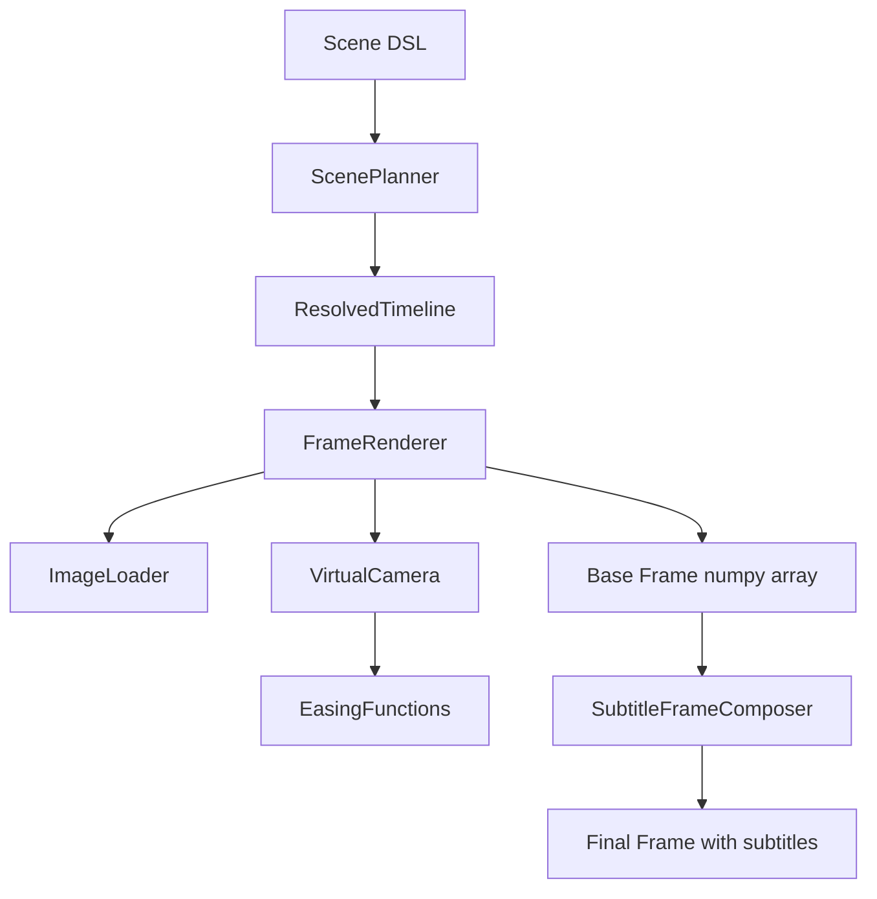

# Design Document: Video Engine Phase 1

## Overview

Phase 1 of the video engine introduces a clip-based video composition system that generates frames from image sequences with camera motion effects. The architecture follows a declarative Scene DSL → planning → frame rendering pipeline, integrating seamlessly with PRISM's existing TTS and subtitle systems.

The design prioritizes simplicity and testability: pure functions for easing curves, stateless camera transforms, and a linear rendering pipeline. No DAG, no complex state management—just clean dataflow from Scene description to rendered frames.

### Key Design Principles

1. **Declarative over imperative**: Users describe what they want (Scene with clips and motion), not how to render it
2. **Composition over inheritance**: Small, focused components that compose cleanly
3. **Pure functions where possible**: Easing functions and camera math are stateless and easily testable
4. **Backward compatibility**: Existing video generation continues to work unchanged when no Scene is provided
5. **Integration not replacement**: The engine generates base frames; the existing subtitle system overlays text

## Architecture

### Component Diagram



### Data Flow

1. **Scene Definition**: User creates Scene with ImageClips and MotionPresets
2. **Planning**: ScenePlanner resolves clip timings and computes camera paths
3. **Frame Rendering**: For each frame at time t:
   - Identify active clip
   - Load source image (with caching)
   - Compute camera viewport using easing-interpolated path
   - Apply crop + resize transform
   - Return numpy array
4. **Subtitle Overlay**: SubtitleFrameComposer receives base frame and adds text
5. **Encoding**: MoviePy writes final video with audio

## Components and Interfaces

### Module Structure

```
engine/
├── __init__.py
├── scene.py           # Scene, ImageClip, MotionPreset dataclasses
├── easing.py          # Easing function library
├── camera.py          # VirtualCamera, Rect, camera path computation
├── planner.py         # ScenePlanner, ResolvedTimeline, ResolvedClip
├── renderer.py        # FrameRenderer
└── image_loader.py    # ImageLoader with caching
```

### Scene DSL (engine/scene.py)

```python
from dataclasses import dataclass, field
from enum import Enum
from pathlib import Path
from typing import Union

class MotionPreset(Enum):
    """Predefined camera movement patterns."""
    STATIC = "static"
    KEN_BURNS_ZOOM_IN = "ken_burns_zoom_in"
    KEN_BURNS_ZOOM_OUT = "ken_burns_zoom_out"
    PAN_LEFT = "pan_left"
    PAN_RIGHT = "pan_right"
    PAN_UP = "pan_up"
    PAN_DOWN = "pan_down"
    ZOOM_IN = "zoom_in"
    ZOOM_OUT = "zoom_out"

@dataclass
class ImageClip:
    """A single image displayed for a duration with optional motion."""
    source: Union[str, Path]
    duration: float  # seconds
    motion: MotionPreset = MotionPreset.STATIC

@dataclass
class Scene:
    """Declarative video composition."""
    clips: list[ImageClip] = field(default_factory=list)
    resolution: tuple[int, int] = (1920, 1080)
    fps: int = 30
```

### Easing Functions (engine/easing.py)

```python
from typing import Callable

EasingFunction = Callable[[float], float]

def linear(t: float) -> float:
    """Linear interpolation: f(t) = t"""
    return t

def ease_in_cubic(t: float) -> float:
    """Cubic ease-in: f(t) = t³"""
    return t * t * t

def ease_out_cubic(t: float) -> float:
    """Cubic ease-out: f(t) = 1 - (1-t)³"""
    return 1 - pow(1 - t, 3)

def ease_in_out_cubic(t: float) -> float:
    """Cubic ease-in-out: smooth acceleration and deceleration"""
    if t < 0.5:
        return 4 * t * t * t
    else:
        return 1 - pow(-2 * t + 2, 3) / 2
```

All easing functions follow the contract:
- Input: progress ∈ [0.0, 1.0]
- Output: eased_progress ∈ [0.0, 1.0]
- f(0) = 0, f(1) = 1

### Virtual Camera (engine/camera.py)

```python
from dataclasses import dataclass
import numpy as np
from PIL import Image
import cv2

@dataclass
class Rect:
    """Rectangle in image coordinates."""
    x: float
    y: float
    width: float
    height: float
    
    def clamp_to(self, image_width: int, image_height: int) -> 'Rect':
        """Clamp rectangle to image boundaries."""
        x = max(0, min(self.x, image_width - self.width))
        y = max(0, min(self.y, image_height - self.height))
        w = min(self.width, image_width)
        h = min(self.height, image_height)
        return Rect(x, y, w, h)

class VirtualCamera:
    """Defines a viewport into a source image."""
    
    def __init__(self, viewport: Rect):
        self.viewport = viewport
    
    def apply_transform(
        self, 
        source_image: np.ndarray, 
        output_size: tuple[int, int]
    ) -> np.ndarray:
        """
        Crop source image to viewport and resize to output size.
        
        Args:
            source_image: HxWx3 numpy array (RGB)
            output_size: (width, height) for output frame
            
        Returns:
            Transformed HxWx3 numpy array
        """
        h, w = source_image.shape[:2]
        viewport = self.viewport.clamp_to(w, h)
        
        # Crop to viewport
        x1 = int(viewport.x)
        y1 = int(viewport.y)
        x2 = int(viewport.x + viewport.width)
        y2 = int(viewport.y + viewport.height)
        cropped = source_image[y1:y2, x1:x2]
        
        # Resize to output size using high-quality interpolation
        resized = cv2.resize(cropped, output_size, interpolation=cv2.INTER_CUBIC)
        return resized
    
    @staticmethod
    def interpolate(
        rect_start: Rect,
        rect_end: Rect,
        progress: float,
        easing_fn: EasingFunction
    ) -> Rect:
        """
        Interpolate between two rectangles using an easing function.
        
        Args:
            rect_start: Starting viewport
            rect_end: Ending viewport
            progress: Time progress in [0, 1]
            easing_fn: Easing function to apply
            
        Returns:
            Interpolated rectangle
        """
        t = easing_fn(progress)
        return Rect(
            x=rect_start.x + (rect_end.x - rect_start.x) * t,
            y=rect_start.y + (rect_end.y - rect_start.y) * t,
            width=rect_start.width + (rect_end.width - rect_start.width) * t,
            height=rect_start.height + (rect_end.height - rect_start.height) * t,
        )
```

### Motion Preset Computation (engine/camera.py)

```python
def compute_motion_path(
    preset: MotionPreset,
    image_size: tuple[int, int],
    output_size: tuple[int, int],
    duration: float
) -> Callable[[float], Rect]:
    """
    Compute a camera path function for a motion preset.
    
    Args:
        preset: Motion pattern to apply
        image_size: (width, height) of source image
        output_size: (width, height) of output frame
        duration: Clip duration in seconds
        
    Returns:
        Function that maps time -> viewport Rect
    """
    img_w, img_h = image_size
    out_w, out_h = output_size
    
    if preset == MotionPreset.STATIC:
        # Center crop to output aspect ratio
        aspect = out_w / out_h
        if img_w / img_h > aspect:
            # Image is wider - fit height
            viewport_h = img_h
            viewport_w = img_h * aspect
        else:
            # Image is taller - fit width
            viewport_w = img_w
            viewport_h = img_w / aspect
        x = (img_w - viewport_w) / 2
        y = (img_h - viewport_h) / 2
        rect = Rect(x, y, viewport_w, viewport_h)
        return lambda t: rect
    
    elif preset == MotionPreset.KEN_BURNS_ZOOM_IN:
        # Start with full image, zoom to 50% centered
        start = Rect(0, 0, img_w, img_h)
        end_w = img_w * 0.5
        end_h = img_h * 0.5
        end = Rect((img_w - end_w) / 2, (img_h - end_h) / 2, end_w, end_h)
        return lambda t: VirtualCamera.interpolate(
            start, end, t / duration, ease_in_out_cubic
        )
    
    elif preset == MotionPreset.KEN_BURNS_ZOOM_OUT:
        # Start at 50% centered, zoom out to full
        start_w = img_w * 0.5
        start_h = img_h * 0.5
        start = Rect((img_w - start_w) / 2, (img_h - start_h) / 2, start_w, start_h)
        end = Rect(0, 0, img_w, img_h)
        return lambda t: VirtualCamera.interpolate(
            start, end, t / duration, ease_in_out_cubic
        )
    
    elif preset == MotionPreset.PAN_LEFT:
        # Viewport moves right (scene moves left)
        viewport_w = out_w
        viewport_h = out_h
        start = Rect(0, 0, viewport_w, viewport_h)
        end = Rect(img_w - viewport_w, 0, viewport_w, viewport_h)
        return lambda t: VirtualCamera.interpolate(
            start, end, t / duration, ease_in_out_cubic
        )
    
    elif preset == MotionPreset.PAN_RIGHT:
        # Viewport moves left (scene moves right)
        viewport_w = out_w
        viewport_h = out_h
        start = Rect(img_w - viewport_w, 0, viewport_w, viewport_h)
        end = Rect(0, 0, viewport_w, viewport_h)
        return lambda t: VirtualCamera.interpolate(
            start, end, t / duration, ease_in_out_cubic
        )
    
    elif preset == MotionPreset.PAN_UP:
        # Viewport moves down (scene moves up)
        viewport_w = out_w
        viewport_h = out_h
        start = Rect(0, 0, viewport_w, viewport_h)
        end = Rect(0, img_h - viewport_h, viewport_w, viewport_h)
        return lambda t: VirtualCamera.interpolate(
            start, end, t / duration, ease_in_out_cubic
        )
    
    elif preset == MotionPreset.PAN_DOWN:
        # Viewport moves up (scene moves down)
        viewport_w = out_w
        viewport_h = out_h
        start = Rect(0, img_h - viewport_h, viewport_w, viewport_h)
        end = Rect(0, 0, viewport_w, viewport_h)
        return lambda t: VirtualCamera.interpolate(
            start, end, t / duration, ease_in_out_cubic
        )
    
    elif preset == MotionPreset.ZOOM_IN:
        # Shrink viewport toward center
        start = Rect(0, 0, img_w, img_h)
        end_w = img_w * 0.5
        end_h = img_h * 0.5
        end = Rect((img_w - end_w) / 2, (img_h - end_h) / 2, end_w, end_h)
        return lambda t: VirtualCamera.interpolate(
            start, end, t / duration, ease_in_out_cubic
        )
    
    elif preset == MotionPreset.ZOOM_OUT:
        # Expand viewport from center
        start_w = img_w * 0.5
        start_h = img_h * 0.5
        start = Rect((img_w - start_w) / 2, (img_h - start_h) / 2, start_w, start_h)
        end = Rect(0, 0, img_w, img_h)
        return lambda t: VirtualCamera.interpolate(
            start, end, t / duration, ease_in_out_cubic
        )
    
    else:
        raise ValueError(f"Unknown motion preset: {preset}")
```

### Scene Planner (engine/planner.py)

```python
from dataclasses import dataclass
from typing import Callable

@dataclass
class ResolvedClip:
    """A clip with computed timing and camera path."""
    source: Path
    start_time: float
    end_time: float
    camera_path: Callable[[float], Rect]  # maps absolute time -> viewport

@dataclass
class ResolvedTimeline:
    """Fully resolved timeline ready for rendering."""
    clips: list[ResolvedClip]
    resolution: tuple[int, int]
    fps: int
    duration: float

class ScenePlanner:
    """Converts Scene DSL into a concrete timeline."""
    
    def plan(self, scene: Scene, image_loader: 'ImageLoader') -> ResolvedTimeline:
        """
        Resolve clip timings and compute camera paths.
        
        Args:
            scene: Scene description
            image_loader: For loading images to get dimensions
            
        Returns:
            ResolvedTimeline ready for rendering
        """
        resolved_clips = []
        current_time = 0.0
        
        for clip in scene.clips:
            # Load image to get dimensions
            image = image_loader.load(clip.source)
            image_size = (image.shape[1], image.shape[0])  # (width, height)
            
            # Compute camera path
            camera_path_fn = compute_motion_path(
                clip.motion,
                image_size,
                scene.resolution,
                clip.duration
            )
            
            # Create resolved clip with absolute timing
            resolved = ResolvedClip(
                source=Path(clip.source),
                start_time=current_time,
                end_time=current_time + clip.duration,
                camera_path=lambda t, fn=camera_path_fn, start=current_time: 
                    fn(t - start)
            )
            resolved_clips.append(resolved)
            current_time += clip.duration
        
        return ResolvedTimeline(
            clips=resolved_clips,
            resolution=scene.resolution,
            fps=scene.fps,
            duration=current_time
        )
```

### Image Loader (engine/image_loader.py)

```python
from pathlib import Path
from typing import Dict
import numpy as np
from PIL import Image

class ImageLoader:
    """Loads and caches images for rendering."""
    
    def __init__(self):
        self._cache: Dict[Path, np.ndarray] = {}
    
    def load(self, path: Union[str, Path]) -> np.ndarray:
        """
        Load an image file and convert to RGB numpy array.
        
        Args:
            path: Path to image file
            
        Returns:
            HxWx3 numpy array in RGB format
            
        Raises:
            FileNotFoundError: If image file doesn't exist
            Exception: If image is corrupted or invalid
        """
        path = Path(path)
        
        # Check cache
        if path in self._cache:
            return self._cache[path]
        
        # Validate file exists
        if not path.exists():
            raise FileNotFoundError(f"Image file not found: {path}")
        
        try:
            # Load and convert to RGB
            pil_image = Image.open(path)
            pil_image = pil_image.convert('RGB')
            array = np.array(pil_image)
            
            # Cache and return
            self._cache[path] = array
            return array
            
        except Exception as e:
            raise Exception(f"Failed to load image {path}: {e}")
    
    def clear_cache(self):
        """Clear the image cache to free memory."""
        self._cache.clear()
```

### Frame Renderer (engine/renderer.py)

```python
import numpy as np
from typing import Optional

class FrameRenderer:
    """Generates video frames from a resolved timeline."""
    
    def __init__(self, timeline: ResolvedTimeline, image_loader: ImageLoader):
        self.timeline = timeline
        self.image_loader = image_loader
        self.output_width, self.output_height = timeline.resolution
    
    def render_frame(self, t: float) -> np.ndarray:
        """
        Render a single frame at time t.
        
        Args:
            t: Time in seconds
            
        Returns:
            HxWx3 numpy array (RGB) at output resolution
        """
        # Find active clip
        active_clip = self._find_active_clip(t)
        
        if active_clip is None:
            # No clip active - return black frame
            return np.zeros(
                (self.output_height, self.output_width, 3), 
                dtype=np.uint8
            )
        
        # Load source image
        source_image = self.image_loader.load(active_clip.source)
        
        # Get camera viewport for this time
        viewport = active_clip.camera_path(t)
        
        # Apply camera transform
        camera = VirtualCamera(viewport)
        frame = camera.apply_transform(
            source_image, 
            (self.output_width, self.output_height)
        )
        
        return frame
    
    def _find_active_clip(self, t: float) -> Optional[ResolvedClip]:
        """Find the clip that is active at time t."""
        for clip in self.timeline.clips:
            if clip.start_time <= t < clip.end_time:
                return clip
        return None
```

## Data Models

### Scene Hierarchy

```
Scene
├── resolution: (width, height)
├── fps: int
└── clips: list[ImageClip]
    ├── source: Path
    ├── duration: float
    └── motion: MotionPreset
```

### Resolved Timeline

```
ResolvedTimeline
├── resolution: (width, height)
├── fps: int
├── duration: float
└── clips: list[ResolvedClip]
    ├── source: Path
    ├── start_time: float
    ├── end_time: float
    └── camera_path: Callable[[float], Rect]
```

### Camera Transform Pipeline

```
Source Image (HxWx3)
    ↓
Viewport Rect (x, y, w, h)
    ↓
Crop Operation
    ↓
Cropped Region
    ↓
Resize to Output Resolution (cv2.INTER_CUBIC)
    ↓
Output Frame (HxWx3)
```

## Integration with Existing Code

### Modified: rendering/video.py

```python
def create_video(
    config: Dict[str, Any],
    *,
    subtitle_source: Optional[ISubtitleSource] = None,
    layout: Optional[ISubtitleLayout] = None,
    renderer: Optional[ISubtitleRenderer] = None,
    scene: Optional[Scene] = None,  # NEW PARAMETER
) -> None:
    """
    Renders the final video by compositing subtitle frames over audio.
    
    If scene is provided, uses FrameRenderer to generate base frames.
    Otherwise, uses solid color background (current behavior).
    """
    # ... existing setup code ...
    
    if scene is not None:
        # NEW: Use engine renderer
        from engine.image_loader import ImageLoader
        from engine.planner import ScenePlanner
        from engine.renderer import FrameRenderer
        
        image_loader = ImageLoader()
        planner = ScenePlanner()
        timeline = planner.plan(scene, image_loader)
        frame_renderer = FrameRenderer(timeline, image_loader)
        
        # Override resolution and fps from scene
        config["width"] = scene.resolution[0]
        config["height"] = scene.resolution[1]
        config["fps"] = scene.fps
        
        # Create composer that uses engine frames as base
        video_settings = {
            "width": config["width"],
            "height": config["height"],
            "bg_color": config["bg_color"],
        }
        
        def make_frame_with_engine(t: float) -> np.ndarray:
            # Get base frame from engine
            base_frame = frame_renderer.render_frame(t)
            
            # Convert to PIL Image for subtitle rendering
            base_image = Image.fromarray(base_frame)
            
            # Get subtitle segments
            if subtitle_config.mode == SubtitleMode.STACKING:
                segments = source.get_all_segments()
            else:
                segments = source.get_segments_for_time(t)
            
            # Layout and render subtitles
            layout_items = layout_impl.layout_frame(
                t, segments, context, subtitle_config
            )
            final_image = renderer_impl.render_frame(
                base_image, layout_items, subtitle_config, context
            )
            
            return np.array(final_image)
        
        video_clip = VideoClip(make_frame_with_engine, duration=timeline.duration)
    else:
        # EXISTING: Use solid background
        composer = SubtitleFrameComposer(
            subtitle_source=source,
            layout=layout_impl,
            renderer=renderer_impl,
            subtitle_config=subtitle_config,
            video_settings=video_settings,
        )
        video_clip = VideoClip(lambda t: composer(t), duration=final_duration)
    
    # ... rest of existing code ...
```

### Modified: api/library.py

```python
def generate_video_from_text(
    text: str,
    output_dir: Path,
    tts_config: Optional[TTSConfig] = None,
    video_config: Optional[VideoConfig] = None,
    subtitle_config: Optional[SubtitleConfig] = None,
    scene: Optional[Scene] = None,  # NEW PARAMETER
) -> Path:
    """
    Generate a narrated video from text.
    
    If scene is provided, generates video with image sequence and motion.
    Otherwise, uses solid color background.
    """
    # ... existing TTS pipeline code ...
    
    # Build config dict for renderer
    renderer_config: Dict[str, Any] = {
        "json_file": str(json_file),
        "audio_file": str(audio_file),
        "output_video": str(video_file),
        "width": video_config.width if scene is None else scene.resolution[0],
        "height": video_config.height if scene is None else scene.resolution[1],
        "fps": video_config.fps if scene is None else scene.fps,
        "bg_color": video_config.bg_color,
        "subtitle": subtitle_config.to_dict(),  # FIX: Now properly passed
    }
    
    # Render video with subtitles
    print("Rendering video with subtitles...")
    create_video(
        renderer_config,
        subtitle_source=None,
        layout=None,
        renderer=None,
        scene=scene,  # NEW: Pass scene through
    )
    
    return video_file
```

### Bug Fix: subtitle_config Propagation

The current code has a bug where `subtitle_config` is not properly passed from `generate_video_from_text` to `create_video`. The fix adds it to the `renderer_config` dict as shown above.


## Correctness Properties

A property is a characteristic or behavior that should hold true across all valid executions of a system—essentially, a formal statement about what the system should do. Properties serve as the bridge between human-readable specifications and machine-verifiable correctness guarantees.

### Property 1: Easing Function Bounds

*For any* easing function (linear, ease_in_cubic, ease_out_cubic, ease_in_out_cubic) and any progress value t in [0.0, 1.0], the output value should be in [0.0, 1.0].

**Validates: Requirements 2.5**

### Property 2: Easing Function Mathematical Correctness

*For any* progress value t in [0.0, 1.0]:
- linear(t) should equal t
- ease_in_cubic(t) should equal t³
- ease_out_cubic(t) should equal 1 - (1-t)³
- ease_in_out_cubic(t) should follow the piecewise cubic formula

**Validates: Requirements 2.1, 2.2, 2.3, 2.4**

### Property 3: Rectangle Interpolation Correctness

*For any* two rectangles (start and end), any progress value t in [0.0, 1.0], and any easing function, interpolating between them should produce a rectangle where each component (x, y, width, height) equals start_component + (end_component - start_component) * easing(t).

**Validates: Requirements 3.5**

### Property 4: Timeline Clip Timing Consistency

*For any* scene with multiple clips, when planning the timeline:
- Each clip's start_time should equal the sum of all previous clip durations
- Each clip's end_time should equal start_time + duration
- Clips should be non-overlapping and sequential

**Validates: Requirements 5.1, 5.2**

### Property 5: Static Motion Invariance

*For any* image clip with STATIC motion preset and any two time values t1 and t2 within the clip duration, the camera viewport at t1 should equal the viewport at t2.

**Validates: Requirements 4.1**

### Property 6: Pan Motion Monotonicity

*For any* image clip with a pan motion preset (PAN_LEFT, PAN_RIGHT, PAN_UP, PAN_DOWN) and any two time values t1 < t2 within the clip duration:
- For PAN_LEFT/PAN_RIGHT: viewport x-coordinate should change monotonically
- For PAN_UP/PAN_DOWN: viewport y-coordinate should change monotonically

**Validates: Requirements 4.4, 4.5, 4.6, 4.7**

### Property 7: Zoom Motion Monotonicity

*For any* image clip with zoom motion (ZOOM_IN, ZOOM_OUT, KEN_BURNS_ZOOM_IN, KEN_BURNS_ZOOM_OUT) and any two time values t1 < t2 within the clip duration:
- For zoom in: viewport area at t2 should be less than or equal to viewport area at t1
- For zoom out: viewport area at t2 should be greater than or equal to viewport area at t1

**Validates: Requirements 4.2, 4.3, 4.8, 4.9**

### Property 8: Camera Transform Output Dimensions

*For any* source image, viewport rectangle, and output resolution, applying the camera transform should produce a numpy array with shape (output_height, output_width, 3).

**Validates: Requirements 3.2, 3.3, 6.6**

### Property 9: Viewport Clamping Safety

*For any* viewport rectangle and source image dimensions, clamping the viewport should produce a rectangle where:
- x >= 0 and x + width <= image_width
- y >= 0 and y + height <= image_height
- width > 0 and height > 0

**Validates: Requirements 10.1**

### Property 10: Frame Renderer Clip Selection

*For any* resolved timeline and time value t, the frame renderer should identify the clip where start_time <= t < end_time, or return None if no such clip exists.

**Validates: Requirements 6.2**

### Property 11: Image Loader Caching

*For any* image path, loading the same image twice should result in only one disk read (the second load should return the cached value).

**Validates: Requirements 9.5**

### Property 12: Image Loader RGB Conversion

*For any* valid image file, loading it should produce a numpy array with shape (height, width, 3) where the third dimension represents RGB channels.

**Validates: Requirements 9.4**

### Property 13: Scene Planning Completeness

*For any* valid scene with N clips, planning should produce a resolved timeline with exactly N resolved clips, each having a valid camera_path function.

**Validates: Requirements 5.6**

## Error Handling

### Image Loading Errors

- **FileNotFoundError**: Raised when image path doesn't exist, includes full path in message
- **Exception**: Raised when image is corrupted or invalid format, includes path and underlying error

### Validation Errors

- **ValueError**: Raised when motion preset is unknown or invalid
- **ValueError**: Raised when scene has invalid configuration (e.g., negative duration)

### Graceful Degradation

- **Missing clip at time t**: Renderer returns black frame instead of crashing
- **Viewport extends beyond image**: Automatically clamped to valid bounds
- **Empty scene**: Timeline with zero duration, no clips

### Error Messages

All error messages should include:
- What went wrong (clear description)
- Which component raised the error
- Relevant context (file paths, time values, etc.)
- Suggestions for fixing when applicable

## Testing Strategy

### Dual Testing Approach

The testing strategy uses both unit tests and property-based tests:

- **Unit tests**: Verify specific examples, edge cases, and error conditions
- **Property tests**: Verify universal properties across all inputs
- Both are complementary and necessary for comprehensive coverage

### Unit Testing Focus

Unit tests should focus on:
- Specific examples that demonstrate correct behavior (e.g., creating a Scene with specific clips)
- Integration points between components (e.g., planner → renderer flow)
- Edge cases and error conditions (e.g., missing image files, empty scenes)
- Backward compatibility (e.g., video generation without Scene parameter)

Avoid writing too many unit tests for cases that property tests cover. Property-based tests handle covering lots of inputs through randomization.

### Property-Based Testing

**Library**: Use `hypothesis` for Python property-based testing

**Configuration**: Each property test must run minimum 100 iterations

**Test Tagging**: Each property test must include a comment referencing the design property:
```python
# Feature: video-engine-phase-1, Property 1: Easing Function Bounds
@given(easing_fn=st.sampled_from([linear, ease_in_cubic, ease_out_cubic, ease_in_out_cubic]),
       t=st.floats(min_value=0.0, max_value=1.0))
def test_easing_bounds(easing_fn, t):
    result = easing_fn(t)
    assert 0.0 <= result <= 1.0
```

**Property Test Coverage**:
- Property 1: Easing function bounds (all easing functions, all valid inputs)
- Property 2: Easing mathematical correctness (formula validation)
- Property 3: Rectangle interpolation (all rectangle pairs, all progress values)
- Property 4: Timeline clip timing (all scene configurations)
- Property 5: Static motion invariance (all time pairs)
- Property 6: Pan motion monotonicity (all pan presets, all time pairs)
- Property 7: Zoom motion monotonicity (all zoom presets, all time pairs)
- Property 8: Camera transform dimensions (all images, viewports, resolutions)
- Property 9: Viewport clamping (all viewports, all image sizes)
- Property 10: Frame renderer clip selection (all timelines, all time values)
- Property 11: Image loader caching (all image paths)
- Property 12: Image loader RGB conversion (all valid images)
- Property 13: Scene planning completeness (all valid scenes)

### Integration Testing

Integration tests should verify:
- Complete pipeline: Scene → Planner → Renderer → Frame output
- Subtitle overlay on engine-generated frames
- Backward compatibility with existing solid-background rendering
- End-to-end video generation with Scene parameter

### Test Fixtures

Create test fixtures in `tests/fixtures/images/`:
- **Landscape images**: 1920x1080, 3840x2160 (4K), 1280x720
- **Portrait images**: 1080x1920, 720x1280
- **Square images**: 1080x1080, 2048x2048
- **Various aspect ratios**: 16:9, 4:3, 21:9, 1:1, 9:16
- **Multiple formats**: PNG (with/without alpha), JPEG, WebP
- **Edge cases**: Very small (100x100), very large (8K), unusual ratios (3:1)
- **Content variety**: Solid colors, gradients, text overlays, complex scenes

Sample scenes for testing:
- Single clip with each motion preset
- Multiple clips (2, 5, 10 clips) with mixed motion presets
- Clips with varying durations (0.5s, 2s, 5s, 10s)
- Scenes with different resolutions (720p, 1080p, 4K)

### Unit Test Coverage

**Scene DSL Tests** (`test_scene_dsl.py`):
- Scene creation with default parameters
- Scene creation with custom resolution and fps
- ImageClip creation with all motion presets
- ImageClip default motion preset is STATIC
- MotionPreset enum has all expected values
- Scene with empty clips list
- Scene with single clip
- Scene with multiple clips

**Easing Function Tests** (`test_easing.py`):
- Each easing function at boundary values (0.0, 1.0)
- Each easing function at midpoint (0.5)
- Linear function returns input unchanged
- Ease-in functions start slow (derivative near 0 at t=0)
- Ease-out functions end slow (derivative near 0 at t=1)
- Ease-in-out functions are symmetric around t=0.5

**Virtual Camera Tests** (`test_camera.py`):
- VirtualCamera creation with viewport
- Rect clamping to image boundaries (various cases)
- Rect clamping with viewport larger than image
- Rect clamping with negative coordinates
- Camera transform with exact-fit viewport (no resize needed)
- Camera transform with viewport smaller than output (upscale)
- Camera transform with viewport larger than output (downscale)
- Rectangle interpolation at t=0 returns start rect
- Rectangle interpolation at t=1 returns end rect
- Rectangle interpolation at t=0.5 with linear easing

**Motion Preset Tests** (`test_motion_presets.py`):
- STATIC motion returns same viewport at t=0 and t=duration
- KEN_BURNS_ZOOM_IN starts with larger viewport than it ends
- KEN_BURNS_ZOOM_OUT ends with larger viewport than it starts
- PAN_LEFT viewport moves rightward (x increases)
- PAN_RIGHT viewport moves leftward (x decreases)
- PAN_UP viewport moves downward (y increases)
- PAN_DOWN viewport moves upward (y decreases)
- ZOOM_IN viewport shrinks (area decreases)
- ZOOM_OUT viewport grows (area increases)
- All motion presets use ease_in_out_cubic by default
- Motion preset with landscape image
- Motion preset with portrait image
- Motion preset with square image

**Scene Planner Tests** (`test_planner.py`):
- Planning empty scene produces empty timeline
- Planning single-clip scene produces correct timing
- Planning multi-clip scene produces sequential timings
- Planning scene with mixed motion presets
- Planner loads images to get dimensions
- Planner creates camera_path functions for each clip
- Timeline duration equals sum of clip durations
- ResolvedClip has all required attributes

**Image Loader Tests** (`test_image_loader.py`):
- Load PNG image successfully
- Load JPEG image successfully
- Load WebP image successfully
- Load image with alpha channel converts to RGB
- Load grayscale image converts to RGB
- Load same image twice uses cache (mock file I/O)
- Load non-existent image raises FileNotFoundError
- Load corrupted image raises exception with message
- Clear cache removes cached images
- Loaded image is numpy array with shape (H, W, 3)
- Loaded image has dtype uint8

**Frame Renderer Tests** (`test_renderer.py`):
- Render frame at t=0 for single-clip timeline
- Render frame at t=duration for single-clip timeline
- Render frame in middle of clip
- Render frame between clips returns black frame
- Render frame before first clip returns black frame
- Render frame after last clip returns black frame
- Render frame with STATIC motion
- Render frame with KEN_BURNS_ZOOM_IN motion
- Render frame with PAN_LEFT motion
- Rendered frame has correct output dimensions
- Rendered frame is numpy array with dtype uint8
- Renderer uses image loader cache

**Integration Tests** (`test_integration.py`):
- Complete pipeline: Scene → Planner → Renderer → Frames
- Render all frames for a 2-second, 2-clip scene at 30fps
- Render scene with real images from fixtures
- Render scene with each motion preset
- Subtitle overlay on engine-generated frame
- Video generation with Scene parameter produces MP4
- Video generation without Scene parameter (backward compatibility)
- Scene resolution overrides video_config resolution
- Scene fps overrides video_config fps
- subtitle_config properly passed through to create_video

**Error Handling Tests** (`test_error_handling.py`):
- Image loader with missing file
- Image loader with corrupted file
- Motion preset with invalid enum value
- Scene with negative clip duration
- Viewport clamping with extreme values
- Renderer with empty timeline
- Renderer with timeline but no clips

### Real Image Testing Strategy

**Visual Regression Tests** (`test_visual_regression.py`):
- Generate reference frames for each motion preset with real images
- Store reference frames as PNG files in `tests/fixtures/reference_frames/`
- Compare rendered frames against reference frames using pixel difference
- Allow small tolerance for floating-point rounding (e.g., max 1% pixel difference)
- Update reference frames when motion algorithms change intentionally

**Real Image Test Cases**:
1. **Landscape photo with Ken Burns zoom in**: Verify smooth zoom toward center
2. **Portrait photo with pan down**: Verify vertical movement from top to bottom
3. **Wide panorama with pan left**: Verify horizontal movement across full width
4. **Square image with zoom out**: Verify expansion from center
5. **High-resolution image (4K) with static**: Verify correct center crop
6. **Low-resolution image with zoom in**: Verify upscaling quality
7. **Complex scene with multiple clips**: Verify smooth transitions between clips

**Image Quality Tests**:
- Verify bicubic interpolation is used (check for smooth edges, no pixelation)
- Verify no color shift during transform (RGB values preserved)
- Verify no artifacts at viewport boundaries
- Verify aspect ratio maintained when viewport and output differ

**Performance Tests with Real Images**:
- Measure frame render time with 1080p images (should be <100ms)
- Measure frame render time with 4K images (should be <500ms)
- Measure memory usage with 10 cached images (should be <500MB)
- Verify cache hit rate (second load should be instant)

### Performance Considerations

While not the focus of Phase 1, tests should verify:
- Image caching reduces load times (measure with timeit)
- Frame rendering completes in reasonable time (<100ms per frame for 1080p)
- Memory usage is bounded (no leaks from image cache)
- Rendering 100 frames doesn't cause memory growth beyond cache size
