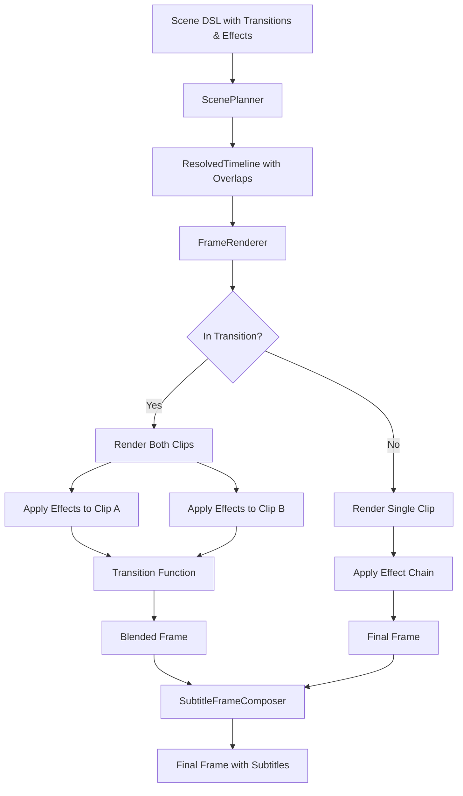

# Design Document: Video Engine Phase 2

## Overview

Phase 2 extends the video engine with transitions and effects, building on Phase 1's clip-based composition system. The architecture maintains the declarative Scene DSL approach while adding two new capabilities: smooth visual transitions between clips (crossfades, slides, wipes) and per-clip effect chains (color grading, vignettes, film grain).

The design follows Phase 1's principles: pure functions for transitions and effects, stateless transforms, and clean dataflow. Transitions are modeled as pure functions `(frame_a, frame_b, progress) -> frame`, and effects as pure functions `(frame, t, progress) -> frame`. The planner computes transition overlaps, and the renderer orchestrates frame blending during transition regions.

### Key Design Principles

1. **Pure functions**: All transitions and effects are stateless, deterministic transforms
2. **Composability**: Effects chain cleanly; transitions compose with Phase 1 camera motion
3. **Backward compatibility**: Phase 1 scenes work unchanged; transitions and effects are opt-in
4. **Protocol-based extensibility**: New transitions and effects can be added without modifying core renderer
5. **Performance-conscious**: In-place operations and buffer reuse minimize allocations

### Integration with Phase 1

Phase 2 extends three Phase 1 components:

- **Scene DSL**: Add `transitions` list to Scene, `effects` list to ImageClip
- **ScenePlanner**: Compute transition overlaps and adjust clip timings
- **FrameRenderer**: Detect transition regions, render both clips, blend frames

All Phase 1 functionality remains unchanged when transitions and effects are not used.

## Architecture

### Component Diagram



### Data Flow with Transitions

1. **Scene Definition**: User creates Scene with clips, transitions, and effects
2. **Planning**: ScenePlanner computes transition overlaps and adjusts clip timings
3. **Frame Rendering**: For each frame at time t:
   - Check if t falls in a transition region
   - If yes: render both clips with their effect chains, blend using transition function
   - If no: render single clip with effect chain (Phase 1 behavior)
4. **Subtitle Overlay**: SubtitleFrameComposer adds text (unchanged from Phase 1)
5. **Encoding**: MoviePy writes final video (unchanged from Phase 1)

### Timeline with Transitions

```
Without transitions (Phase 1):
Clip A: [0.0 -------- 3.0]
Clip B:                  [3.0 -------- 6.0]
Clip C:                                   [6.0 -------- 9.0]

With transitions (Phase 2):
Clip A: [0.0 -------- 3.0]
                    [2.5 - 3.5] Transition A→B (1.0s)
Clip B:              [2.5 -------- 5.5]
                                [5.0 - 6.0] Transition B→C (1.0s)
Clip C:                          [5.0 -------- 8.0]

Total duration: 8.0s (not 9.0s due to overlaps)
```

## Components and Interfaces

### Module Structure

```
engine/
├── __init__.py
├── scene.py           # Scene, ImageClip, MotionPreset, Transition (UPDATED)
├── easing.py          # Easing functions (unchanged from Phase 1)
├── camera.py          # VirtualCamera, Rect (unchanged from Phase 1)
├── planner.py         # ScenePlanner, ResolvedTimeline (UPDATED)
├── renderer.py        # FrameRenderer (UPDATED)
├── image_loader.py    # ImageLoader (unchanged from Phase 1)
├── transitions.py     # Transition implementations (NEW)
└── effects.py         # Effect implementations (NEW)
```

### Updated Scene DSL (engine/scene.py)

```python
from dataclasses import dataclass, field
from enum import Enum
from pathlib import Path
from typing import Union, Protocol, Callable
import numpy as np

# Phase 1 enums (unchanged)
class MotionPreset(Enum):
    STATIC = "static"
    KEN_BURNS_ZOOM_IN = "ken_burns_zoom_in"
    KEN_BURNS_ZOOM_OUT = "ken_burns_zoom_out"
    PAN_LEFT = "pan_left"
    PAN_RIGHT = "pan_right"
    PAN_UP = "pan_up"
    PAN_DOWN = "pan_down"
    ZOOM_IN = "zoom_in"
    ZOOM_OUT = "zoom_out"

# NEW: Transition types
class TransitionType(Enum):
    # Blend transitions
    CROSSFADE = "crossfade"
    FADE_THROUGH_BLACK = "fade_through_black"
    FADE_THROUGH_WHITE = "fade_through_white"
    
    # Geometric transitions
    SLIDE_LEFT = "slide_left"
    SLIDE_RIGHT = "slide_right"
    SLIDE_UP = "slide_up"
    SLIDE_DOWN = "slide_down"
    PUSH_LEFT = "push_left"
    PUSH_RIGHT = "push_right"
    PUSH_UP = "push_up"
    PUSH_DOWN = "push_down"
    WIPE_LEFT = "wipe_left"
    WIPE_RIGHT = "wipe_right"
    WIPE_UP = "wipe_up"
    WIPE_DOWN = "wipe_down"
    IRIS_OPEN = "iris_open"
    IRIS_CLOSE = "iris_close"
    CLOCK_WIPE = "clock_wipe"
    DIAMOND_WIPE = "diamond_wipe"
    BLINDS_HORIZONTAL = "blinds_horizontal"
    BLINDS_VERTICAL = "blinds_vertical"
    
    # Animated transitions
    ZOOM_THROUGH = "zoom_through"
    WHIP_PAN = "whip_pan"
    PIXELATE = "pixelate"
    GLITCH = "glitch"

# NEW: Transition function protocol
class TransitionFunction(Protocol):
    """Protocol for transition functions."""
    def __call__(
        self, 
        frame_a: np.ndarray, 
        frame_b: np.ndarray, 
        progress: float
    ) -> np.ndarray:
        """
        Blend two frames based on transition progress.
        
        Args:
            frame_a: Outgoing frame (HxWx3 uint8)
            frame_b: Incoming frame (HxWx3 uint8)
            progress: Transition progress in [0.0, 1.0]
            
        Returns:
            Blended frame (HxWx3 uint8)
        """
        ...

# NEW: Effect function protocol
class EffectFunction(Protocol):
    """Protocol for effect functions."""
    def __call__(
        self, 
        frame: np.ndarray, 
        t: float, 
        progress: float
    ) -> np.ndarray:
        """
        Apply visual effect to a frame.
        
        Args:
            frame: Input frame (HxWx3 uint8)
            t: Absolute time in seconds
            progress: Clip progress in [0.0, 1.0]
            
        Returns:
            Processed frame (HxWx3 uint8)
        """
        ...

# NEW: Transition dataclass
@dataclass
class Transition:
    """Defines a transition between two clips."""
    type: TransitionType
    duration: float  # seconds
    easing: 'EasingFunction' = None  # defaults to ease_in_out_cubic
    
    def __post_init__(self):
        if self.duration <= 0:
            raise ValueError(f"Transition duration must be positive, got {self.duration}")
        if self.easing is None:
            from .easing import ease_in_out_cubic
            self.easing = ease_in_out_cubic

# UPDATED: ImageClip with effects
@dataclass
class ImageClip:
    """A single image displayed for a duration with optional motion and effects."""
    source: Union[str, Path]
    duration: float  # seconds
    motion: MotionPreset = MotionPreset.STATIC
    effects: list[EffectFunction] = field(default_factory=list)  # NEW

# UPDATED: Scene with transitions
@dataclass
class Scene:
    """Declarative video composition with transitions and effects."""
    clips: list[ImageClip] = field(default_factory=list)
    resolution: tuple[int, int] = (1920, 1080)
    fps: int = 30
    transitions: list[Transition] = field(default_factory=list)  # NEW
    
    def __post_init__(self):
        # Validate transitions count
        if len(self.transitions) > len(self.clips) - 1:
            raise ValueError(
                f"Scene has {len(self.clips)} clips but {len(self.transitions)} transitions. "
                f"Maximum transitions is {len(self.clips) - 1}."
            )
```


### Transition Implementations (engine/transitions.py)

```python
"""Transition function implementations."""

from __future__ import annotations
import numpy as np
import cv2
from typing import TYPE_CHECKING

if TYPE_CHECKING:
    from .scene import TransitionType

# ============================================================================
# Blend Transitions
# ============================================================================

def crossfade(frame_a: np.ndarray, frame_b: np.ndarray, progress: float) -> np.ndarray:
    """
    Linear crossfade between two frames.
    
    Formula: result = frame_a * (1 - progress) + frame_b * progress
    """
    alpha = progress
    blended = (frame_a * (1 - alpha) + frame_b * alpha).astype(np.uint8)
    return blended

def fade_through_black(frame_a: np.ndarray, frame_b: np.ndarray, progress: float) -> np.ndarray:
    """
    Fade to black in first half, then fade from black in second half.
    
    Progress [0.0, 0.5]: frame_a fades to black
    Progress [0.5, 1.0]: black fades to frame_b
    """
    if progress < 0.5:
        # Fade out frame_a
        fade_progress = 1.0 - (progress * 2.0)
        return (frame_a * fade_progress).astype(np.uint8)
    else:
        # Fade in frame_b
        fade_progress = (progress - 0.5) * 2.0
        return (frame_b * fade_progress).astype(np.uint8)

def fade_through_white(frame_a: np.ndarray, frame_b: np.ndarray, progress: float) -> np.ndarray:
    """
    Fade to white in first half, then fade from white in second half.
    
    Progress [0.0, 0.5]: frame_a fades to white
    Progress [0.5, 1.0]: white fades to frame_b
    """
    white = np.full_like(frame_a, 255, dtype=np.uint8)
    
    if progress < 0.5:
        # Fade to white
        fade_progress = progress * 2.0
        return (frame_a * (1 - fade_progress) + white * fade_progress).astype(np.uint8)
    else:
        # Fade from white
        fade_progress = (progress - 0.5) * 2.0
        return (white * (1 - fade_progress) + frame_b * fade_progress).astype(np.uint8)

# ============================================================================
# Geometric Transitions - Slides
# ============================================================================

def slide_left(frame_a: np.ndarray, frame_b: np.ndarray, progress: float) -> np.ndarray:
    """
    Slide frame_b from right to left over frame_a.
    
    Frame_b enters from the right edge and moves left.
    """
    h, w = frame_a.shape[:2]
    offset = int(w * (1 - progress))
    
    result = frame_a.copy()
    if offset < w:
        # Copy the visible portion of frame_b
        visible_width = w - offset
        result[:, offset:] = frame_b[:, :visible_width]
    
    return result

def slide_right(frame_a: np.ndarray, frame_b: np.ndarray, progress: float) -> np.ndarray:
    """Slide frame_b from left to right over frame_a."""
    h, w = frame_a.shape[:2]
    offset = int(w * progress)
    
    result = frame_a.copy()
    if offset > 0:
        visible_width = min(offset, w)
        result[:, :visible_width] = frame_b[:, w - visible_width:]
    
    return result

def slide_up(frame_a: np.ndarray, frame_b: np.ndarray, progress: float) -> np.ndarray:
    """Slide frame_b from bottom to top over frame_a."""
    h, w = frame_a.shape[:2]
    offset = int(h * (1 - progress))
    
    result = frame_a.copy()
    if offset < h:
        visible_height = h - offset
        result[offset:, :] = frame_b[:visible_height, :]
    
    return result

def slide_down(frame_a: np.ndarray, frame_b: np.ndarray, progress: float) -> np.ndarray:
    """Slide frame_b from top to bottom over frame_a."""
    h, w = frame_a.shape[:2]
    offset = int(h * progress)
    
    result = frame_a.copy()
    if offset > 0:
        visible_height = min(offset, h)
        result[:visible_height, :] = frame_b[h - visible_height:, :]
    
    return result

# ============================================================================
# Geometric Transitions - Pushes
# ============================================================================

def push_left(frame_a: np.ndarray, frame_b: np.ndarray, progress: float) -> np.ndarray:
    """
    Push frame_a left while frame_b enters from right.
    
    Both frames move together.
    """
    h, w = frame_a.shape[:2]
    offset = int(w * progress)
    
    result = np.zeros_like(frame_a)
    
    # Frame_a portion (moving left)
    if offset < w:
        visible_a = w - offset
        result[:, :visible_a] = frame_a[:, offset:]
    
    # Frame_b portion (entering from right)
    if offset > 0:
        result[:, w - offset:] = frame_b[:, :offset]
    
    return result

def push_right(frame_a: np.ndarray, frame_b: np.ndarray, progress: float) -> np.ndarray:
    """Push frame_a right while frame_b enters from left."""
    h, w = frame_a.shape[:2]
    offset = int(w * progress)
    
    result = np.zeros_like(frame_a)
    
    # Frame_b portion (entering from left)
    if offset > 0:
        result[:, :offset] = frame_b[:, w - offset:]
    
    # Frame_a portion (moving right)
    if offset < w:
        visible_a = w - offset
        result[:, offset:] = frame_a[:, :visible_a]
    
    return result

def push_up(frame_a: np.ndarray, frame_b: np.ndarray, progress: float) -> np.ndarray:
    """Push frame_a up while frame_b enters from bottom."""
    h, w = frame_a.shape[:2]
    offset = int(h * progress)
    
    result = np.zeros_like(frame_a)
    
    # Frame_a portion (moving up)
    if offset < h:
        visible_a = h - offset
        result[:visible_a, :] = frame_a[offset:, :]
    
    # Frame_b portion (entering from bottom)
    if offset > 0:
        result[h - offset:, :] = frame_b[:offset, :]
    
    return result

def push_down(frame_a: np.ndarray, frame_b: np.ndarray, progress: float) -> np.ndarray:
    """Push frame_a down while frame_b enters from top."""
    h, w = frame_a.shape[:2]
    offset = int(h * progress)
    
    result = np.zeros_like(frame_a)
    
    # Frame_b portion (entering from top)
    if offset > 0:
        result[:offset, :] = frame_b[h - offset:, :]
    
    # Frame_a portion (moving down)
    if offset < h:
        visible_a = h - offset
        result[offset:, :] = frame_a[:visible_a, :]
    
    return result

# ============================================================================
# Geometric Transitions - Wipes
# ============================================================================

def wipe_left(frame_a: np.ndarray, frame_b: np.ndarray, progress: float) -> np.ndarray:
    """
    Wipe from left to right with hard edge.
    
    Frame_b is revealed from left to right.
    """
    h, w = frame_a.shape[:2]
    split = int(w * progress)
    
    result = frame_a.copy()
    if split > 0:
        result[:, :split] = frame_b[:, :split]
    
    return result

def wipe_right(frame_a: np.ndarray, frame_b: np.ndarray, progress: float) -> np.ndarray:
    """Wipe from right to left with hard edge."""
    h, w = frame_a.shape[:2]
    split = int(w * (1 - progress))
    
    result = frame_a.copy()
    if split < w:
        result[:, split:] = frame_b[:, split:]
    
    return result

def wipe_up(frame_a: np.ndarray, frame_b: np.ndarray, progress: float) -> np.ndarray:
    """Wipe from top to bottom with hard edge."""
    h, w = frame_a.shape[:2]
    split = int(h * progress)
    
    result = frame_a.copy()
    if split > 0:
        result[:split, :] = frame_b[:split, :]
    
    return result

def wipe_down(frame_a: np.ndarray, frame_b: np.ndarray, progress: float) -> np.ndarray:
    """Wipe from bottom to top with hard edge."""
    h, w = frame_a.shape[:2]
    split = int(h * (1 - progress))
    
    result = frame_a.copy()
    if split < h:
        result[split:, :] = frame_b[split:, :]
    
    return result

# ============================================================================
# Geometric Transitions - Shapes
# ============================================================================

def iris_open(frame_a: np.ndarray, frame_b: np.ndarray, progress: float) -> np.ndarray:
    """
    Reveal frame_b through expanding circle from center.
    
    Creates a circular mask that grows from center.
    """
    h, w = frame_a.shape[:2]
    center_y, center_x = h // 2, w // 2
    max_radius = np.sqrt(center_x**2 + center_y**2)
    radius = int(max_radius * progress)
    
    # Create circular mask
    y, x = np.ogrid[:h, :w]
    mask = ((x - center_x)**2 + (y - center_y)**2) <= radius**2
    mask = mask[:, :, np.newaxis]  # Add channel dimension
    
    result = np.where(mask, frame_b, frame_a)
    return result.astype(np.uint8)

def iris_close(frame_a: np.ndarray, frame_b: np.ndarray, progress: float) -> np.ndarray:
    """
    Reveal frame_b outside shrinking circle from center.
    
    Frame_a is visible inside circle, frame_b outside.
    """
    h, w = frame_a.shape[:2]
    center_y, center_x = h // 2, w // 2
    max_radius = np.sqrt(center_x**2 + center_y**2)
    radius = int(max_radius * (1 - progress))
    
    # Create circular mask
    y, x = np.ogrid[:h, :w]
    mask = ((x - center_x)**2 + (y - center_y)**2) <= radius**2
    mask = mask[:, :, np.newaxis]
    
    result = np.where(mask, frame_a, frame_b)
    return result.astype(np.uint8)

def clock_wipe(frame_a: np.ndarray, frame_b: np.ndarray, progress: float) -> np.ndarray:
    """
    Clockwise sweep from 12 o'clock.
    
    Reveals frame_b in a clockwise sweep starting from top.
    """
    h, w = frame_a.shape[:2]
    center_y, center_x = h // 2, w // 2
    
    # Create angle map
    y, x = np.ogrid[:h, :w]
    angles = np.arctan2(y - center_y, x - center_x)
    # Rotate so 0 is at top (12 o'clock)
    angles = (angles + np.pi / 2) % (2 * np.pi)
    
    # Progress maps to angle threshold
    threshold = progress * 2 * np.pi
    mask = angles <= threshold
    mask = mask[:, :, np.newaxis]
    
    result = np.where(mask, frame_b, frame_a)
    return result.astype(np.uint8)

def diamond_wipe(frame_a: np.ndarray, frame_b: np.ndarray, progress: float) -> np.ndarray:
    """
    Reveal frame_b through expanding diamond from center.
    
    Uses Manhattan distance for diamond shape.
    """
    h, w = frame_a.shape[:2]
    center_y, center_x = h // 2, w // 2
    max_distance = center_x + center_y
    threshold = int(max_distance * progress)
    
    # Create diamond mask using Manhattan distance
    y, x = np.ogrid[:h, :w]
    distance = np.abs(x - center_x) + np.abs(y - center_y)
    mask = distance <= threshold
    mask = mask[:, :, np.newaxis]
    
    result = np.where(mask, frame_b, frame_a)
    return result.astype(np.uint8)

def blinds_horizontal(frame_a: np.ndarray, frame_b: np.ndarray, progress: float) -> np.ndarray:
    """
    Reveal frame_b through horizontal strips.
    
    Creates venetian blind effect with horizontal slats.
    """
    h, w = frame_a.shape[:2]
    num_blinds = 10
    blind_height = h // num_blinds
    
    result = frame_a.copy()
    reveal_height = int(blind_height * progress)
    
    for i in range(num_blinds):
        start_y = i * blind_height
        end_y = min(start_y + reveal_height, (i + 1) * blind_height)
        if end_y > start_y:
            result[start_y:end_y, :] = frame_b[start_y:end_y, :]
    
    return result

def blinds_vertical(frame_a: np.ndarray, frame_b: np.ndarray, progress: float) -> np.ndarray:
    """Reveal frame_b through vertical strips."""
    h, w = frame_a.shape[:2]
    num_blinds = 10
    blind_width = w // num_blinds
    
    result = frame_a.copy()
    reveal_width = int(blind_width * progress)
    
    for i in range(num_blinds):
        start_x = i * blind_width
        end_x = min(start_x + reveal_width, (i + 1) * blind_width)
        if end_x > start_x:
            result[:, start_x:end_x] = frame_b[:, start_x:end_x]
    
    return result

# ============================================================================
# Animated Transitions
# ============================================================================

def zoom_through(frame_a: np.ndarray, frame_b: np.ndarray, progress: float) -> np.ndarray:
    """
    Zoom in on frame_a while fading out, zoom out from frame_b while fading in.
    
    Creates a "zoom through" effect.
    """
    h, w = frame_a.shape[:2]
    
    # Scale factor: frame_a zooms in, frame_b zooms out
    scale_a = 1.0 + progress * 0.5  # 1.0 -> 1.5
    scale_b = 1.5 - progress * 0.5  # 1.5 -> 1.0
    
    # Resize frames
    new_size_a = (int(w * scale_a), int(h * scale_a))
    new_size_b = (int(w * scale_b), int(h * scale_b))
    
    scaled_a = cv2.resize(frame_a, new_size_a, interpolation=cv2.INTER_CUBIC)
    scaled_b = cv2.resize(frame_b, new_size_b, interpolation=cv2.INTER_CUBIC)
    
    # Center crop to original size
    crop_a = _center_crop(scaled_a, w, h)
    crop_b = _center_crop(scaled_b, w, h)
    
    # Crossfade with progress
    alpha = progress
    result = (crop_a * (1 - alpha) + crop_b * alpha).astype(np.uint8)
    return result

def whip_pan(frame_a: np.ndarray, frame_b: np.ndarray, progress: float) -> np.ndarray:
    """
    Fast horizontal motion blur effect.
    
    Creates a whip pan by applying horizontal motion blur.
    """
    # Use aggressive easing for whip effect
    if progress < 0.3:
        # Mostly frame_a with increasing blur
        blur_amount = int(progress * 100)
        if blur_amount > 1:
            blurred = cv2.blur(frame_a, (blur_amount, 1))
            return blurred
        return frame_a
    elif progress > 0.7:
        # Mostly frame_b with decreasing blur
        blur_amount = int((1 - progress) * 100)
        if blur_amount > 1:
            blurred = cv2.blur(frame_b, (blur_amount, 1))
            return blurred
        return frame_b
    else:
        # Peak blur - blend both frames
        blur_amount = 30
        blurred_a = cv2.blur(frame_a, (blur_amount, 1))
        blurred_b = cv2.blur(frame_b, (blur_amount, 1))
        return ((blurred_a + blurred_b) // 2).astype(np.uint8)

def pixelate(frame_a: np.ndarray, frame_b: np.ndarray, progress: float) -> np.ndarray:
    """
    Pixelate frame_a while un-pixelating frame_b.
    
    Creates a digital transition effect.
    """
    h, w = frame_a.shape[:2]
    
    # Pixelation level: high at progress=0.5, low at edges
    if progress < 0.5:
        # Pixelate frame_a
        pixel_progress = progress * 2.0
        pixel_size = max(1, int(50 * pixel_progress))
        
        small = cv2.resize(frame_a, (w // pixel_size, h // pixel_size), 
                          interpolation=cv2.INTER_NEAREST)
        pixelated_a = cv2.resize(small, (w, h), interpolation=cv2.INTER_NEAREST)
        
        # Blend with frame_b
        alpha = pixel_progress
        result = (pixelated_a * (1 - alpha) + frame_b * alpha).astype(np.uint8)
    else:
        # Un-pixelate frame_b
        pixel_progress = (1.0 - progress) * 2.0
        pixel_size = max(1, int(50 * pixel_progress))
        
        small = cv2.resize(frame_b, (w // pixel_size, h // pixel_size),
                          interpolation=cv2.INTER_NEAREST)
        pixelated_b = cv2.resize(small, (w, h), interpolation=cv2.INTER_NEAREST)
        
        alpha = 1.0 - pixel_progress
        result = (pixelated_b * (1 - alpha) + frame_b * alpha).astype(np.uint8)
    
    return result

def glitch(frame_a: np.ndarray, frame_b: np.ndarray, progress: float) -> np.ndarray:
    """
    Digital glitch effect with RGB channel shifts and scanlines.
    
    Creates a digital distortion transition.
    """
    h, w = frame_a.shape[:2]
    
    # Glitch intensity peaks at progress=0.5
    intensity = 1.0 - abs(progress - 0.5) * 2.0
    
    # Start with crossfade
    alpha = progress
    base = (frame_a * (1 - alpha) + frame_b * alpha).astype(np.uint8)
    
    if intensity < 0.1:
        return base
    
    # RGB channel shift
    shift = int(20 * intensity)
    result = base.copy()
    if shift > 0:
        result[:, shift:, 0] = base[:, :-shift, 0]  # Red channel shift
        result[:, :-shift, 2] = base[:, shift:, 2]  # Blue channel shift
    
    # Add scanlines
    if np.random.random() < intensity:
        scanline_spacing = max(2, int(10 * (1 - intensity)))
        for y in range(0, h, scanline_spacing):
            if np.random.random() < 0.5:
                result[y, :] = result[y, :] * 0.7
    
    return result.astype(np.uint8)

# ============================================================================
# Helper Functions
# ============================================================================

def _center_crop(image: np.ndarray, target_w: int, target_h: int) -> np.ndarray:
    """Crop image to target size from center."""
    h, w = image.shape[:2]
    start_y = (h - target_h) // 2
    start_x = (w - target_w) // 2
    return image[start_y:start_y + target_h, start_x:start_x + target_w]

# ============================================================================
# Transition Registry
# ============================================================================

def get_transition_function(transition_type: 'TransitionType') -> 'TransitionFunction':
    """
    Get the transition function for a given transition type.
    
    Args:
        transition_type: The type of transition
        
    Returns:
        Transition function
        
    Raises:
        ValueError: If transition type is unknown
    """
    from .scene import TransitionType
    
    registry = {
        TransitionType.CROSSFADE: crossfade,
        TransitionType.FADE_THROUGH_BLACK: fade_through_black,
        TransitionType.FADE_THROUGH_WHITE: fade_through_white,
        TransitionType.SLIDE_LEFT: slide_left,
        TransitionType.SLIDE_RIGHT: slide_right,
        TransitionType.SLIDE_UP: slide_up,
        TransitionType.SLIDE_DOWN: slide_down,
        TransitionType.PUSH_LEFT: push_left,
        TransitionType.PUSH_RIGHT: push_right,
        TransitionType.PUSH_UP: push_up,
        TransitionType.PUSH_DOWN: push_down,
        TransitionType.WIPE_LEFT: wipe_left,
        TransitionType.WIPE_RIGHT: wipe_right,
        TransitionType.WIPE_UP: wipe_up,
        TransitionType.WIPE_DOWN: wipe_down,
        TransitionType.IRIS_OPEN: iris_open,
        TransitionType.IRIS_CLOSE: iris_close,
        TransitionType.CLOCK_WIPE: clock_wipe,
        TransitionType.DIAMOND_WIPE: diamond_wipe,
        TransitionType.BLINDS_HORIZONTAL: blinds_horizontal,
        TransitionType.BLINDS_VERTICAL: blinds_vertical,
        TransitionType.ZOOM_THROUGH: zoom_through,
        TransitionType.WHIP_PAN: whip_pan,
        TransitionType.PIXELATE: pixelate,
        TransitionType.GLITCH: glitch,
    }
    
    if transition_type not in registry:
        raise ValueError(f"Unknown transition type: {transition_type}")
    
    return registry[transition_type]
```


### Effect Implementations (engine/effects.py)

```python
"""Effect function implementations."""

from __future__ import annotations
import numpy as np
import cv2
from typing import Callable

# ============================================================================
# Color Effects
# ============================================================================

def brightness(amount: float) -> Callable[[np.ndarray, float, float], np.ndarray]:
    """
    Create a brightness adjustment effect.
    
    Args:
        amount: Brightness adjustment (-1.0 to 1.0)
                Positive values increase brightness
                Negative values decrease brightness
                
    Returns:
        Effect function
    """
    def effect(frame: np.ndarray, t: float, progress: float) -> np.ndarray:
        # Convert to float for arithmetic
        adjusted = frame.astype(np.float32) + (amount * 255)
        # Clamp to valid range
        adjusted = np.clip(adjusted, 0, 255)
        return adjusted.astype(np.uint8)
    
    return effect

def contrast(amount: float) -> Callable[[np.ndarray, float, float], np.ndarray]:
    """
    Create a contrast adjustment effect.
    
    Args:
        amount: Contrast multiplier (0.0 to 2.0)
                1.0 = no change
                >1.0 = increase contrast
                <1.0 = decrease contrast
                
    Returns:
        Effect function
    """
    def effect(frame: np.ndarray, t: float, progress: float) -> np.ndarray:
        # Convert to float and center around 128
        adjusted = (frame.astype(np.float32) - 128) * amount + 128
        # Clamp to valid range
        adjusted = np.clip(adjusted, 0, 255)
        return adjusted.astype(np.uint8)
    
    return effect

def saturation(amount: float) -> Callable[[np.ndarray, float, float], np.ndarray]:
    """
    Create a saturation adjustment effect.
    
    Args:
        amount: Saturation multiplier (0.0 to 2.0)
                1.0 = no change
                >1.0 = increase saturation
                <1.0 = decrease saturation
                0.0 = grayscale
                
    Returns:
        Effect function
    """
    def effect(frame: np.ndarray, t: float, progress: float) -> np.ndarray:
        # Convert RGB to HSV
        hsv = cv2.cvtColor(frame, cv2.COLOR_RGB2HSV).astype(np.float32)
        
        # Adjust saturation channel
        hsv[:, :, 1] = np.clip(hsv[:, :, 1] * amount, 0, 255)
        
        # Convert back to RGB
        hsv = hsv.astype(np.uint8)
        rgb = cv2.cvtColor(hsv, cv2.COLOR_HSV2RGB)
        return rgb
    
    return effect

def vignette(
    intensity: float = 0.5,
    radius: float = 0.8
) -> Callable[[np.ndarray, float, float], np.ndarray]:
    """
    Create a vignette effect (darkened edges).
    
    Args:
        intensity: Darkness of vignette (0.0 to 1.0)
        radius: Size of bright center (0.0 to 1.0)
                Larger values = larger bright area
                
    Returns:
        Effect function
    """
    def effect(frame: np.ndarray, t: float, progress: float) -> np.ndarray:
        h, w = frame.shape[:2]
        center_y, center_x = h // 2, w // 2
        
        # Create radial gradient
        y, x = np.ogrid[:h, :w]
        distances = np.sqrt((x - center_x)**2 + (y - center_y)**2)
        max_distance = np.sqrt(center_x**2 + center_y**2)
        
        # Normalize distances
        normalized = distances / max_distance
        
        # Apply vignette curve
        mask = np.clip((normalized - radius) / (1 - radius), 0, 1)
        mask = 1 - (mask * intensity)
        mask = mask[:, :, np.newaxis]  # Add channel dimension
        
        # Apply mask
        result = (frame * mask).astype(np.uint8)
        return result
    
    return effect

# ============================================================================
# Texture Effects
# ============================================================================

def film_grain(
    intensity: float = 0.1,
    seed: int = None
) -> Callable[[np.ndarray, float, float], np.ndarray]:
    """
    Create a film grain effect.
    
    Args:
        intensity: Grain intensity (0.0 to 1.0)
        seed: Random seed for reproducibility (None = time-based)
                
    Returns:
        Effect function
    """
    def effect(frame: np.ndarray, t: float, progress: float) -> np.ndarray:
        # Use time-based seed for different grain per frame
        if seed is None:
            np.random.seed(int(t * 1000) % (2**32))
        else:
            np.random.seed(seed + int(t * 1000))
        
        # Generate grain
        h, w = frame.shape[:2]
        grain = np.random.normal(0, intensity * 255, (h, w, 3))
        
        # Add grain to frame
        result = frame.astype(np.float32) + grain
        result = np.clip(result, 0, 255)
        return result.astype(np.uint8)
    
    return effect

# ============================================================================
# Animated Effects
# ============================================================================

def fade_in(duration: float) -> Callable[[np.ndarray, float, float], np.ndarray]:
    """
    Create a fade-in effect from black.
    
    Args:
        duration: Fade duration in seconds
                
    Returns:
        Effect function
    """
    def effect(frame: np.ndarray, t: float, progress: float) -> np.ndarray:
        # Use clip progress for fade
        fade_progress = min(progress * (1.0 / duration) if duration > 0 else 1.0, 1.0)
        result = (frame * fade_progress).astype(np.uint8)
        return result
    
    return effect

def fade_out(duration: float) -> Callable[[np.ndarray, float, float], np.ndarray]:
    """
    Create a fade-out effect to black.
    
    Args:
        duration: Fade duration in seconds
                
    Returns:
        Effect function
    """
    def effect(frame: np.ndarray, t: float, progress: float) -> np.ndarray:
        # Fade out in the last 'duration' seconds
        fade_progress = max(0.0, 1.0 - (progress - (1.0 - duration)) / duration)
        result = (frame * fade_progress).astype(np.uint8)
        return result
    
    return effect

def pulse(
    frequency: float = 1.0,
    amount: float = 0.2
) -> Callable[[np.ndarray, float, float], np.ndarray]:
    """
    Create a pulsing brightness effect.
    
    Args:
        frequency: Pulses per second
        amount: Pulse intensity (0.0 to 1.0)
                
    Returns:
        Effect function
    """
    def effect(frame: np.ndarray, t: float, progress: float) -> np.ndarray:
        # Sine wave based on absolute time
        pulse_value = np.sin(t * frequency * 2 * np.pi) * amount
        multiplier = 1.0 + pulse_value
        
        result = (frame.astype(np.float32) * multiplier)
        result = np.clip(result, 0, 255)
        return result.astype(np.uint8)
    
    return effect

# ============================================================================
# Effect Utilities
# ============================================================================

def chain_effects(*effects: Callable) -> Callable[[np.ndarray, float, float], np.ndarray]:
    """
    Chain multiple effects together.
    
    Args:
        *effects: Effect functions to chain
        
    Returns:
        Combined effect function
    """
    def combined_effect(frame: np.ndarray, t: float, progress: float) -> np.ndarray:
        result = frame
        for effect in effects:
            result = effect(result, t, progress)
        return result
    
    return combined_effect
```


### Updated Scene Planner (engine/planner.py)

```python
"""Scene planning with transition overlap computation."""

from __future__ import annotations
from dataclasses import dataclass
from typing import Callable, Optional
from pathlib import Path
import numpy as np

from .scene import Scene, Transition
from .camera import Rect

@dataclass
class ResolvedClip:
    """A clip with computed timing and camera path."""
    source: Path
    start_time: float
    end_time: float
    camera_path: Callable[[float], Rect]
    effects: list  # List of effect functions

@dataclass
class TransitionRegion:
    """Defines a transition between two clips."""
    start_time: float
    end_time: float
    clip_a_index: int
    clip_b_index: int
    transition_function: Callable
    easing_function: Callable

@dataclass
class ResolvedTimeline:
    """Fully resolved timeline with transitions."""
    clips: list[ResolvedClip]
    transitions: list[TransitionRegion]
    resolution: tuple[int, int]
    fps: int
    duration: float

class ScenePlanner:
    """Converts Scene DSL into a concrete timeline with transitions."""
    
    def plan(self, scene: Scene, image_loader: 'ImageLoader') -> ResolvedTimeline:
        """
        Resolve clip timings, compute camera paths, and plan transitions.
        
        Args:
            scene: Scene description
            image_loader: For loading images to get dimensions
            
        Returns:
            ResolvedTimeline ready for rendering
            
        Raises:
            ValueError: If transition durations are invalid
        """
        from .camera import compute_motion_path
        from .transitions import get_transition_function
        
        # Validate transitions
        self._validate_transitions(scene)
        
        resolved_clips = []
        transition_regions = []
        current_time = 0.0
        
        for i, clip in enumerate(scene.clips):
            # Load image to get dimensions
            image = image_loader.load(clip.source)
            image_size = (image.shape[1], image.shape[0])
            
            # Compute camera path
            camera_path_fn = compute_motion_path(
                clip.motion,
                image_size,
                scene.resolution,
                clip.duration
            )
            
            # Determine clip timing
            if i > 0 and i - 1 < len(scene.transitions):
                # This clip overlaps with previous due to transition
                transition = scene.transitions[i - 1]
                overlap = transition.duration
                start_time = current_time - overlap
            else:
                start_time = current_time
            
            end_time = start_time + clip.duration
            
            # Create resolved clip
            resolved = ResolvedClip(
                source=Path(clip.source),
                start_time=start_time,
                end_time=end_time,
                camera_path=lambda t, fn=camera_path_fn, start=start_time: fn(t - start),
                effects=clip.effects.copy()
            )
            resolved_clips.append(resolved)
            
            # Create transition region if applicable
            if i > 0 and i - 1 < len(scene.transitions):
                transition = scene.transitions[i - 1]
                transition_fn = get_transition_function(transition.type)
                
                transition_region = TransitionRegion(
                    start_time=start_time,
                    end_time=start_time + transition.duration,
                    clip_a_index=i - 1,
                    clip_b_index=i,
                    transition_function=transition_fn,
                    easing_function=transition.easing
                )
                transition_regions.append(transition_region)
            
            # Advance time (accounting for overlap)
            if i < len(scene.clips) - 1 and i < len(scene.transitions):
                transition = scene.transitions[i]
                current_time = end_time - transition.duration
            else:
                current_time = end_time
        
        total_duration = resolved_clips[-1].end_time if resolved_clips else 0.0
        
        return ResolvedTimeline(
            clips=resolved_clips,
            transitions=transition_regions,
            resolution=scene.resolution,
            fps=scene.fps,
            duration=total_duration
        )
    
    def _validate_transitions(self, scene: Scene) -> None:
        """
        Validate transition configuration.
        
        Raises:
            ValueError: If transitions are invalid
        """
        if len(scene.transitions) > len(scene.clips) - 1:
            raise ValueError(
                f"Scene has {len(scene.clips)} clips but {len(scene.transitions)} transitions. "
                f"Maximum transitions is {len(scene.clips) - 1}."
            )
        
        for i, transition in enumerate(scene.transitions):
            if transition.duration <= 0:
                raise ValueError(
                    f"Transition {i} has invalid duration: {transition.duration}. "
                    f"Duration must be positive."
                )
            
            # Check that transition doesn't exceed clip durations
            if i < len(scene.clips) - 1:
                clip_a_duration = scene.clips[i].duration
                clip_b_duration = scene.clips[i + 1].duration
                min_duration = min(clip_a_duration, clip_b_duration)
                
                if transition.duration > min_duration:
                    raise ValueError(
                        f"Transition {i} duration ({transition.duration}s) exceeds "
                        f"the shorter clip duration ({min_duration}s). "
                        f"Transition between clips {i} and {i+1}."
                    )
```


### Updated Frame Renderer (engine/renderer.py)

```python
"""Frame rendering with transition and effect support."""

from __future__ import annotations
import numpy as np
from typing import Optional

from .planner import ResolvedTimeline, ResolvedClip, TransitionRegion
from .image_loader import ImageLoader
from .camera import VirtualCamera

class FrameRenderer:
    """Generates video frames from a resolved timeline with transitions and effects."""
    
    def __init__(self, timeline: ResolvedTimeline, image_loader: ImageLoader):
        self.timeline = timeline
        self.image_loader = image_loader
        self.output_width, self.output_height = timeline.resolution
    
    def render_frame(self, t: float) -> np.ndarray:
        """
        Render a single frame at time t, handling transitions and effects.
        
        Args:
            t: Time in seconds
            
        Returns:
            HxWx3 numpy array (RGB) at output resolution
        """
        # Check if we're in a transition region
        transition = self._find_transition_at_time(t)
        
        if transition is not None:
            # Render both clips and blend
            return self._render_transition_frame(t, transition)
        else:
            # Render single clip (Phase 1 behavior)
            return self._render_single_clip_frame(t)
    
    def _render_single_clip_frame(self, t: float) -> np.ndarray:
        """Render a frame from a single clip with effects."""
        active_clip = self._find_active_clip(t)
        
        if active_clip is None:
            # No clip active - return black frame
            return np.zeros(
                (self.output_height, self.output_width, 3),
                dtype=np.uint8
            )
        
        # Render base frame from clip
        base_frame = self._render_clip_base(active_clip, t)
        
        # Apply effect chain
        final_frame = self._apply_effects(base_frame, active_clip, t)
        
        return final_frame
    
    def _render_transition_frame(self, t: float, transition: TransitionRegion) -> np.ndarray:
        """Render a frame during a transition between two clips."""
        clip_a = self.timeline.clips[transition.clip_a_index]
        clip_b = self.timeline.clips[transition.clip_b_index]
        
        # Validate frame dimensions will match
        # (Both clips render to same output resolution, so this should always pass)
        
        # Render both clips with their effect chains
        frame_a = self._render_clip_base(clip_a, t)
        frame_a = self._apply_effects(frame_a, clip_a, t)
        
        frame_b = self._render_clip_base(clip_b, t)
        frame_b = self._apply_effects(frame_b, clip_b, t)
        
        # Validate dimensions match
        if frame_a.shape != frame_b.shape:
            raise ValueError(
                f"Frame dimension mismatch during transition: "
                f"clip {transition.clip_a_index} produced {frame_a.shape}, "
                f"clip {transition.clip_b_index} produced {frame_b.shape}"
            )
        
        # Compute transition progress
        transition_duration = transition.end_time - transition.start_time
        raw_progress = (t - transition.start_time) / transition_duration
        raw_progress = np.clip(raw_progress, 0.0, 1.0)
        
        # Apply easing
        eased_progress = transition.easing_function(raw_progress)
        
        # Blend frames using transition function
        blended_frame = transition.transition_function(frame_a, frame_b, eased_progress)
        
        return blended_frame
    
    def _render_clip_base(self, clip: ResolvedClip, t: float) -> np.ndarray:
        """Render the base frame from a clip (camera transform only, no effects)."""
        # Load source image
        source_image = self.image_loader.load(clip.source)
        
        # Get camera viewport for this time
        viewport = clip.camera_path(t)
        
        # Apply camera transform
        camera = VirtualCamera(viewport)
        frame = camera.apply_transform(
            source_image,
            (self.output_width, self.output_height)
        )
        
        return frame
    
    def _apply_effects(
        self,
        frame: np.ndarray,
        clip: ResolvedClip,
        t: float
    ) -> np.ndarray:
        """Apply the effect chain to a frame."""
        if not clip.effects:
            return frame
        
        # Compute clip progress
        clip_duration = clip.end_time - clip.start_time
        progress = (t - clip.start_time) / clip_duration if clip_duration > 0 else 0.0
        progress = np.clip(progress, 0.0, 1.0)
        
        # Apply effects in sequence
        result = frame
        for i, effect in enumerate(clip.effects):
            try:
                processed = effect(result, t, progress)
                
                # Validate effect output
                if processed.shape != result.shape:
                    raise ValueError(
                        f"Effect {i} changed frame dimensions from {result.shape} to {processed.shape}"
                    )
                if processed.dtype != result.dtype:
                    raise ValueError(
                        f"Effect {i} changed frame dtype from {result.dtype} to {processed.dtype}"
                    )
                
                result = processed
                
            except Exception as e:
                raise Exception(
                    f"Error applying effect {i} to clip at {clip.source} at time {t:.2f}s: {e}"
                ) from e
        
        return result
    
    def _find_active_clip(self, t: float) -> Optional[ResolvedClip]:
        """Find the clip that is active at time t (excluding transition regions)."""
        # Check if we're in a transition
        if self._find_transition_at_time(t) is not None:
            return None
        
        # Find clip containing t
        for clip in self.timeline.clips:
            if clip.start_time <= t < clip.end_time:
                return clip
        
        return None
    
    def _find_transition_at_time(self, t: float) -> Optional[TransitionRegion]:
        """Find the transition region active at time t."""
        for transition in self.timeline.transitions:
            if transition.start_time <= t < transition.end_time:
                return transition
        
        return None
```


## Data Models

### Transition Data Flow

```
Transition (Scene DSL)
├── type: TransitionType
├── duration: float
└── easing: EasingFunction
    ↓
TransitionRegion (Resolved Timeline)
├── start_time: float
├── end_time: float
├── clip_a_index: int
├── clip_b_index: int
├── transition_function: TransitionFunction
└── easing_function: EasingFunction
    ↓
Blended Frame (Renderer Output)
```

### Effect Data Flow

```
ImageClip.effects: list[EffectFunction]
    ↓
ResolvedClip.effects: list[EffectFunction]
    ↓
For each effect in sequence:
    frame = effect(frame, t, progress)
    ↓
Final processed frame
```

### Timeline Structure with Transitions

```
ResolvedTimeline
├── clips: list[ResolvedClip]
│   ├── source: Path
│   ├── start_time: float (may overlap with previous)
│   ├── end_time: float (may overlap with next)
│   ├── camera_path: Callable[[float], Rect]
│   └── effects: list[EffectFunction]
├── transitions: list[TransitionRegion]
│   ├── start_time: float (= clip_b.start_time)
│   ├── end_time: float (= clip_b.start_time + duration)
│   ├── clip_a_index: int
│   ├── clip_b_index: int
│   ├── transition_function: TransitionFunction
│   └── easing_function: EasingFunction
├── resolution: (width, height)
├── fps: int
└── duration: float
```

## Correctness Properties

A property is a characteristic or behavior that should hold true across all valid executions of a system—essentially, a formal statement about what the system should do. Properties serve as the bridge between human-readable specifications and machine-verifiable correctness guarantees.

### Property Reflection

After analyzing all acceptance criteria, I identified the following redundancies:
- Requirements 2.5 and 2.6 (blend transition boundaries) are subsumed by 10.3 and 10.4 (general transition boundaries)
- Requirement 2.7 (easing for blend transitions) is subsumed by 4.5 (easing for all transitions)
- Requirement 5.6 (effect dimension validation) is covered by 11.3 (effect protocol requirement)
- Requirements 12.3 and 12.4 (clips without effects) are both covered by 5.5 (no effects behavior)
- Requirements 13.5 and 10.7 (frame dimension validation) are the same requirement
- Requirements 14.1 and 5.6 (effect dimension validation) are duplicates

The consolidated properties below eliminate these redundancies while maintaining complete coverage.

### Property 1: Transition Duration Validation

*For any* transition with duration D, D must be positive, and when used between two clips with durations d1 and d2, D must not exceed min(d1, d2).

**Validates: Requirements 1.3, 8.6, 13.1, 13.2**

### Property 2: Scene Transition Count Validation

*For any* scene with N clips and T transitions, T must be at most N-1, otherwise a ValueError should be raised.

**Validates: Requirements 1.6, 13.3**

### Property 3: Missing Transitions Render as Cuts

*For any* scene with N clips and fewer than N-1 transitions, rendering at the boundary between clips without a transition should show an instant cut (no blending).

**Validates: Requirements 1.7**

### Property 4: Crossfade Mathematical Correctness

*For any* two frames frame_a and frame_b, and any progress p in [0.0, 1.0], crossfade(frame_a, frame_b, p) should equal frame_a * (1-p) + frame_b * p (within rounding tolerance).

**Validates: Requirements 2.1**

### Property 5: Fade Through Black Behavior

*For any* two frames and any progress p in [0.0, 1.0], fade_through_black should darken frame_a when p < 0.5 and brighten frame_b when p >= 0.5.

**Validates: Requirements 2.2**

### Property 6: Fade Through White Behavior

*For any* two frames and any progress p in [0.0, 1.0], fade_through_white should brighten frame_a toward white when p < 0.5 and darken from white to frame_b when p >= 0.5.

**Validates: Requirements 2.3**

### Property 7: Transition Boundary Conditions

*For any* transition function and any two frames frame_a and frame_b:
- When progress = 0.0, the output should be visually identical to frame_a (all pixels equal)
- When progress = 1.0, the output should be visually identical to frame_b (all pixels equal)

**Validates: Requirements 2.5, 2.6, 10.3, 10.4**

### Property 8: Transition Easing Application

*For any* transition with an easing function, the renderer should apply the easing function to raw progress before passing it to the transition function.

**Validates: Requirements 2.7, 4.5, 9.5**

### Property 9: Slide Transition Monotonicity

*For any* slide transition (SLIDE_LEFT, SLIDE_RIGHT, SLIDE_UP, SLIDE_DOWN) and any two progress values p1 < p2, the visible area of frame_b at p2 should be greater than or equal to the visible area at p1.

**Validates: Requirements 3.1, 3.2, 3.3, 3.4**

### Property 10: Push Transition Frame Coverage

*For any* push transition (PUSH_LEFT, PUSH_RIGHT, PUSH_UP, PUSH_DOWN) and any progress p, every pixel in the output should come from either frame_a or frame_b (no black regions).

**Validates: Requirements 3.5, 3.6, 3.7, 3.8**

### Property 11: Wipe Transition Hard Edge

*For any* wipe transition (WIPE_LEFT, WIPE_RIGHT, WIPE_UP, WIPE_DOWN) and any progress p, there should exist a clear boundary where pixels are either entirely from frame_a or entirely from frame_b (no blending).

**Validates: Requirements 3.9, 3.10, 3.11, 3.12**

### Property 12: Shape Transition Geometric Correctness

*For any* shape transition (IRIS_OPEN, IRIS_CLOSE, CLOCK_WIPE, DIAMOND_WIPE) and any progress p in [0.0, 1.0], the revealed area of frame_b should increase monotonically with p.

**Validates: Requirements 3.14, 3.15, 3.16, 3.17**

### Property 13: Blinds Transition Strip Count

*For any* blinds transition (BLINDS_HORIZONTAL, BLINDS_VERTICAL), the output should show exactly 10 strips revealing frame_b progressively.

**Validates: Requirements 3.18, 3.19**

### Property 14: Animated Transition Frame Validity

*For any* animated transition (ZOOM_THROUGH, WHIP_PAN, PIXELATE, GLITCH) and any progress p, the output frame should have valid dimensions and dtype matching the input frames.

**Validates: Requirements 4.1, 4.2, 4.3, 4.4**

### Property 15: Effect Chain Ordering

*For any* clip with effects [e1, e2, ..., en], applying the effects should produce the same result as applying e1, then e2, ..., then en in sequence.

**Validates: Requirements 5.3**

### Property 16: No Effects Preserves Frame

*For any* clip with an empty effects list or no effects attribute, rendering the clip should produce a frame identical to the base camera-transformed frame.

**Validates: Requirements 5.5, 12.3, 12.4**

### Property 17: Effect Dimension Preservation

*For any* effect function and any input frame, the output frame must have identical shape and dtype to the input, otherwise a ValueError should be raised.

**Validates: Requirements 5.6, 11.3, 14.1, 14.2**

### Property 18: Brightness Effect Monotonicity

*For any* frame and brightness amount:
- When amount > 0, output pixels should be brighter than input pixels (on average)
- When amount < 0, output pixels should be darker than input pixels (on average)
- When amount = 0, output should equal input

**Validates: Requirements 6.1, 6.2**

### Property 19: Contrast Effect Behavior

*For any* frame and contrast amount:
- When amount > 1.0, the standard deviation of pixel values should increase
- When amount < 1.0, the standard deviation of pixel values should decrease
- When amount = 1.0, output should equal input

**Validates: Requirements 6.3, 6.4**

### Property 20: Saturation Effect Behavior

*For any* frame and saturation amount:
- When amount > 1.0, the saturation channel in HSV space should increase
- When amount < 1.0, the saturation channel in HSV space should decrease
- When amount = 0.0, output should be grayscale

**Validates: Requirements 6.5, 6.6**

### Property 21: Vignette Effect Edge Darkening

*For any* frame with vignette applied, pixels near the edges should be darker than pixels near the center (comparing same-color regions).

**Validates: Requirements 6.7**

### Property 22: Color Value Clamping

*For any* effect and any input frame, all output pixel values should be in the range [0, 255].

**Validates: Requirements 6.8**

### Property 23: Film Grain Adds Noise

*For any* frame with film_grain applied, the output should differ from the input, and the difference should be random noise.

**Validates: Requirements 7.1**

### Property 24: Film Grain Intensity Scaling

*For any* frame and two intensity values i1 < i2, applying film_grain with i2 should produce more variation from the original than i1.

**Validates: Requirements 7.2**

### Property 25: Film Grain Temporal Variation

*For any* frame and two different time values t1 and t2, film_grain(frame, t1) should produce different noise patterns than film_grain(frame, t2).

**Validates: Requirements 7.3**

### Property 26: Film Grain Brightness Preservation

*For any* frame with film_grain applied, the mean brightness of the output should be approximately equal to the mean brightness of the input (within tolerance).

**Validates: Requirements 7.4**

### Property 27: Timeline Overlap Computation

*For any* scene with transitions, the planner should create overlap regions where clip_n.end_time > clip_n+1.start_time, and the overlap duration should equal the transition duration.

**Validates: Requirements 8.1, 8.2, 8.3**

### Property 28: Sequential Timing Without Transitions

*For any* scene with no transitions or empty transitions list, the planner should create clips with sequential timing where clip_n.end_time = clip_n+1.start_time.

**Validates: Requirements 8.4, 12.1, 12.2**

### Property 29: Transition Region Creation

*For any* scene with T transitions, the resolved timeline should contain exactly T transition regions, each with correct clip indices and timing.

**Validates: Requirements 8.5**

### Property 30: Renderer Transition Detection

*For any* resolved timeline and time t, the renderer should correctly identify whether t falls within a transition region, and if so, identify both clips involved.

**Validates: Requirements 9.1, 9.2**

### Property 31: Transition Rendering Process

*For any* time t within a transition region, the renderer should:
1. Render both clips with their effect chains
2. Compute progress as (t - transition.start_time) / transition.duration
3. Apply easing to progress
4. Call transition function with both frames and eased progress

**Validates: Requirements 9.3, 9.4, 9.5, 9.6**

### Property 32: Single Clip Rendering Outside Transitions

*For any* time t not in a transition region, the renderer should render exactly one clip (or black frame if no clip is active), matching Phase 1 behavior.

**Validates: Requirements 9.7**

### Property 33: Transition Progress Range

*For any* transition function call, the progress parameter should always be in the range [0.0, 1.0].

**Validates: Requirements 10.2, 11.2**

### Property 34: Transition Frame Dimension Matching

*For any* transition function call, frame_a and frame_b must have identical dimensions, otherwise a ValueError should be raised before calling the function.

**Validates: Requirements 10.7, 13.5**

### Property 35: Transition Output Dimensions

*For any* transition function and input frames, the output frame must have the same shape and dtype as the input frames.

**Validates: Requirements 10.5**

### Property 36: Invalid Transition Type Rejection

*For any* invalid transition type value, the system should raise a ValueError when attempting to get the transition function.

**Validates: Requirements 13.4**


## Error Handling

### Transition Errors

**ValueError - Invalid Duration**:
- Raised when transition duration is negative or zero
- Message includes the invalid duration value
- Example: "Transition duration must be positive, got -0.5"

**ValueError - Duration Exceeds Clip**:
- Raised when transition duration exceeds the shorter of two adjacent clips
- Message includes transition index, clip indices, and durations
- Example: "Transition 0 duration (2.0s) exceeds the shorter clip duration (1.5s). Transition between clips 0 and 1."

**ValueError - Too Many Transitions**:
- Raised when scene has more transitions than N-1 for N clips
- Message includes clip count and transition count
- Example: "Scene has 3 clips but 4 transitions. Maximum transitions is 2."

**ValueError - Invalid Transition Type**:
- Raised when transition type is not in TransitionType enum
- Message includes the invalid type value
- Example: "Unknown transition type: invalid_type"

**ValueError - Frame Dimension Mismatch**:
- Raised when frames have different dimensions during transition
- Message includes both frame shapes and clip indices
- Example: "Frame dimension mismatch during transition: clip 0 produced (1080, 1920, 3), clip 1 produced (720, 1280, 3)"

### Effect Errors

**ValueError - Dimension Change**:
- Raised when effect returns frame with different dimensions
- Message includes effect index, clip index, and both shapes
- Example: "Effect 0 changed frame dimensions from (1080, 1920, 3) to (720, 1280, 3)"

**ValueError - Dtype Change**:
- Raised when effect returns frame with different dtype
- Message includes effect index, clip index, and both dtypes
- Example: "Effect 0 changed frame dtype from uint8 to float32"

**Exception - Effect Application Failure**:
- Raised when effect function raises an exception
- Wraps original exception with context
- Message includes effect index, clip source, and time
- Example: "Error applying effect 1 to clip at images/photo.jpg at time 2.50s: division by zero"

### Graceful Degradation

**Missing Transitions**:
- Scene with fewer transitions than N-1 renders with instant cuts at missing transitions
- No error raised, renders successfully

**Empty Effects List**:
- Clip with empty effects list renders base frame without effects
- No error raised, renders successfully

**Time Outside Timeline**:
- Rendering at t < 0 or t >= duration returns black frame
- No error raised, renders successfully

### Error Message Guidelines

All error messages should:
- Clearly state what went wrong
- Include relevant indices (transition index, clip index, effect index)
- Include relevant values (durations, dimensions, dtypes)
- Suggest how to fix when applicable
- Use consistent formatting

## Testing Strategy

### Dual Testing Approach

The testing strategy uses both unit tests and property-based tests:

- **Unit tests**: Verify specific examples, edge cases, and error conditions
- **Property tests**: Verify universal properties across all inputs
- Both are complementary and necessary for comprehensive coverage

Unit tests should focus on:
- Specific transition examples (e.g., crossfade at progress=0.5 with known frames)
- Integration points (e.g., planner → renderer with transitions)
- Edge cases (e.g., transition at timeline start/end)
- Error conditions (e.g., invalid transition duration)
- Backward compatibility (e.g., Phase 1 scenes still work)

Avoid writing too many unit tests for cases that property tests cover. Property-based tests handle covering lots of inputs through randomization.

### Property-Based Testing

**Library**: Use `hypothesis` for Python property-based testing

**Configuration**: Each property test must run minimum 100 iterations

**Test Tagging**: Each property test must include a comment referencing the design property:
```python
# Feature: video-engine-phase-2, Property 4: Crossfade Mathematical Correctness
@given(frame_a=frame_strategy(), frame_b=frame_strategy(), progress=st.floats(min_value=0.0, max_value=1.0))
@settings(max_examples=100)
def test_crossfade_formula(frame_a, frame_b, progress):
    result = crossfade(frame_a, frame_b, progress)
    expected = (frame_a * (1 - progress) + frame_b * progress).astype(np.uint8)
    assert np.allclose(result, expected, atol=1)
```

**Property Test Coverage**:

Each of the 36 properties should have a corresponding property-based test:

1. **Property 1**: Test transition duration validation with random durations and clip lengths
2. **Property 2**: Test scene transition count validation with random clip and transition counts
3. **Property 3**: Test missing transitions render as cuts by checking pixel equality at boundaries
4. **Property 4**: Test crossfade formula with random frames and progress values
5. **Property 5**: Test fade_through_black darkening/brightening with random frames
6. **Property 6**: Test fade_through_white brightening/darkening with random frames
7. **Property 7**: Test all transition functions at progress=0.0 and progress=1.0
8. **Property 8**: Test easing application by comparing with/without easing
9. **Property 9**: Test slide transitions with monotonically increasing visible area
10. **Property 10**: Test push transitions have no black pixels
11. **Property 11**: Test wipe transitions have hard edges (no partial blending)
12. **Property 12**: Test shape transitions have monotonically increasing revealed area
13. **Property 13**: Test blinds transitions have exactly 10 strips
14. **Property 14**: Test animated transitions produce valid frames
15. **Property 15**: Test effect chain ordering with observable effects
16. **Property 16**: Test clips without effects produce base frames
17. **Property 17**: Test effects preserve dimensions and dtype
18. **Property 18**: Test brightness effect increases/decreases pixel values
19. **Property 19**: Test contrast effect increases/decreases standard deviation
20. **Property 20**: Test saturation effect modifies HSV saturation channel
21. **Property 21**: Test vignette darkens edges more than center
22. **Property 22**: Test all effects clamp values to [0, 255]
23. **Property 23**: Test film_grain adds noise
24. **Property 24**: Test film_grain intensity scaling
25. **Property 25**: Test film_grain temporal variation
26. **Property 26**: Test film_grain preserves mean brightness
27. **Property 27**: Test timeline overlap computation
28. **Property 28**: Test sequential timing without transitions
29. **Property 29**: Test transition region creation
30. **Property 30**: Test renderer transition detection
31. **Property 31**: Test transition rendering process
32. **Property 32**: Test single clip rendering outside transitions
33. **Property 33**: Test transition progress range
34. **Property 34**: Test frame dimension matching validation
35. **Property 35**: Test transition output dimensions
36. **Property 36**: Test invalid transition type rejection

### Hypothesis Strategies

**Frame Strategy**:
```python
@st.composite
def frame_strategy(draw):
    """Generate random frames for testing."""
    width = draw(st.integers(min_value=100, max_value=1920))
    height = draw(st.integers(min_value=100, max_value=1080))
    # Generate random RGB values
    frame = draw(st.integers(min_value=0, max_value=255).map(
        lambda _: np.random.randint(0, 256, (height, width, 3), dtype=np.uint8)
    ))
    return frame
```

**Scene Strategy**:
```python
@st.composite
def scene_strategy(draw):
    """Generate random scenes for testing."""
    num_clips = draw(st.integers(min_value=1, max_value=5))
    clips = []
    for _ in range(num_clips):
        duration = draw(st.floats(min_value=0.5, max_value=5.0))
        motion = draw(st.sampled_from(list(MotionPreset)))
        clips.append(ImageClip(source="test.jpg", duration=duration, motion=motion))
    
    # Generate valid transitions (at most num_clips - 1)
    num_transitions = draw(st.integers(min_value=0, max_value=num_clips - 1))
    transitions = []
    for i in range(num_transitions):
        max_duration = min(clips[i].duration, clips[i+1].duration)
        duration = draw(st.floats(min_value=0.1, max_value=max_duration * 0.9))
        trans_type = draw(st.sampled_from(list(TransitionType)))
        transitions.append(Transition(type=trans_type, duration=duration))
    
    return Scene(clips=clips, transitions=transitions)
```

### Integration Testing

Integration tests should verify:

1. **Complete pipeline with transitions**: Scene → Planner → Renderer → Frames with transitions
2. **Effect chain integration**: Clips with multiple effects render correctly
3. **Transition + effects**: Both clips have effects during transition
4. **Backward compatibility**: Phase 1 scenes render identically
5. **End-to-end video generation**: Scene with transitions produces valid MP4
6. **Subtitle overlay on transitioned frames**: Subtitles render correctly during transitions

### Unit Testing Focus

**Transition Function Tests** (`test_transitions.py`):
- Each transition type with known input frames
- Boundary conditions (progress=0.0, 0.5, 1.0)
- Visual verification for geometric transitions (slides, wipes, shapes)
- Animated transitions produce expected effects

**Effect Function Tests** (`test_effects.py`):
- Each effect type with known input frames
- Brightness/contrast/saturation with various amounts
- Vignette with various intensities and radii
- Film grain with various intensities
- Animated effects (fade_in, fade_out, pulse) at different times

**Planner Tests** (`test_planner.py`):
- Planning scene with transitions computes correct overlaps
- Planning scene without transitions uses sequential timing
- Validation catches invalid transition configurations
- Transition regions have correct clip indices and timing

**Renderer Tests** (`test_renderer.py`):
- Rendering during transition calls both clips
- Rendering outside transition calls single clip
- Effect chain applied in correct order
- Error handling for dimension mismatches

**Scene DSL Tests** (`test_scene_dsl.py`):
- Transition dataclass creation
- TransitionType enum has all expected values
- Scene validation catches too many transitions
- ImageClip with effects list

**Error Handling Tests** (`test_error_handling.py`):
- Invalid transition duration raises ValueError
- Transition exceeding clip duration raises ValueError
- Too many transitions raises ValueError
- Effect dimension change raises ValueError
- Effect dtype change raises ValueError
- Frame dimension mismatch raises ValueError

### Visual Regression Testing

**Reference Frame Generation**:
- Generate reference frames for each transition type at progress=[0.0, 0.25, 0.5, 0.75, 1.0]
- Generate reference frames for each effect type
- Store as PNG files in `tests/fixtures/reference_frames/phase2/`

**Comparison Strategy**:
- Compare rendered frames against reference frames
- Allow small tolerance for floating-point rounding (max 1% pixel difference)
- Update reference frames when algorithms change intentionally

**Test Cases**:
1. **Crossfade transition**: Verify smooth blending
2. **Slide transitions**: Verify directional movement
3. **Wipe transitions**: Verify hard edges
4. **Iris transitions**: Verify circular reveal
5. **Animated transitions**: Verify motion effects
6. **Brightness effect**: Verify pixel intensity changes
7. **Contrast effect**: Verify contrast changes
8. **Saturation effect**: Verify color saturation changes
9. **Vignette effect**: Verify edge darkening
10. **Film grain effect**: Verify noise addition
11. **Effect chain**: Verify multiple effects compose correctly
12. **Transition with effects**: Verify both clips have effects applied

### Performance Testing

**Transition Performance**:
- Measure render time for each transition type (should be <200ms per frame at 1080p)
- Compare blend transitions (fast) vs animated transitions (slower)
- Verify no memory leaks during long sequences

**Effect Performance**:
- Measure render time for each effect type
- Verify effect chains don't cause exponential slowdown
- Compare Phase 2 rendering with effects to Phase 1 baseline (should be within 2x)

**Integration Performance**:
- Render 100-frame sequence with transitions and effects
- Measure total time and memory usage
- Verify performance is acceptable for production use

### Test Fixtures

**Images** (`tests/fixtures/images/`):
- Reuse Phase 1 fixtures (landscape, portrait, square, various resolutions)
- Add high-contrast images for testing effects
- Add colorful images for testing saturation effects

**Scenes** (`tests/fixtures/scenes/`):
- Single clip with each transition type
- Multiple clips with mixed transitions
- Clips with effect chains
- Clips with transitions and effects combined
- Edge cases (very short clips, very long transitions)

### Backward Compatibility Testing

**Phase 1 Regression Tests**:
- Run all Phase 1 tests to ensure no regressions
- Verify Phase 1 scenes render identically
- Verify Phase 1 API still works
- Verify Phase 1 performance is maintained

**Migration Tests**:
- Phase 1 Scene without transitions attribute works
- Phase 1 ImageClip without effects attribute works
- Adding transitions to existing scene works
- Adding effects to existing clips works

## Integration with Existing Code

### Modified: engine/scene.py

The Scene and ImageClip dataclasses are extended with new attributes:
- Scene gains `transitions: list[Transition]` attribute
- ImageClip gains `effects: list[EffectFunction]` attribute
- Both default to empty lists for backward compatibility

### Modified: engine/planner.py

The ScenePlanner is updated to:
- Compute transition overlaps when planning timeline
- Validate transition durations against clip durations
- Create TransitionRegion objects for each transition
- Adjust clip timings to account for overlaps

### Modified: engine/renderer.py

The FrameRenderer is updated to:
- Detect transition regions at render time
- Render both clips during transitions
- Apply effect chains to clips before blending
- Call transition functions with eased progress
- Validate frame dimensions during transitions

### New: engine/transitions.py

New module containing:
- All transition function implementations
- Transition registry mapping TransitionType to functions
- Helper functions for geometric computations

### New: engine/effects.py

New module containing:
- All effect function implementations
- Effect factory functions (brightness, contrast, etc.)
- Effect composition utilities

### Unchanged Modules

These Phase 1 modules remain unchanged:
- `engine/easing.py`: Easing functions work as-is
- `engine/camera.py`: Camera transforms work as-is
- `engine/image_loader.py`: Image loading works as-is

### API Compatibility

The existing API remains fully compatible:
- `generate_video_from_text()` works without Scene parameter (Phase 1 behavior)
- `generate_video_from_text()` accepts Scene with transitions and effects (Phase 2 behavior)
- All Phase 1 Scene objects work unchanged
- New Scene objects with transitions and effects work seamlessly

## Example Usage

### Basic Transition Example

```python
from engine.scene import Scene, ImageClip, Transition, TransitionType, MotionPreset

scene = Scene(
    clips=[
        ImageClip(source="image1.jpg", duration=3.0, motion=MotionPreset.KEN_BURNS_ZOOM_IN),
        ImageClip(source="image2.jpg", duration=3.0, motion=MotionPreset.PAN_LEFT),
        ImageClip(source="image3.jpg", duration=3.0, motion=MotionPreset.STATIC),
    ],
    transitions=[
        Transition(type=TransitionType.CROSSFADE, duration=1.0),
        Transition(type=TransitionType.SLIDE_LEFT, duration=0.5),
    ],
    resolution=(1920, 1080),
    fps=30
)

# Total duration: 3.0 + 3.0 + 3.0 - 1.0 - 0.5 = 7.5 seconds
```

### Effect Chain Example

```python
from engine.scene import Scene, ImageClip, MotionPreset
from engine.effects import brightness, contrast, vignette, film_grain

scene = Scene(
    clips=[
        ImageClip(
            source="image1.jpg",
            duration=5.0,
            motion=MotionPreset.KEN_BURNS_ZOOM_IN,
            effects=[
                brightness(0.1),      # Slightly brighter
                contrast(1.2),        # More contrast
                vignette(intensity=0.3),  # Subtle vignette
                film_grain(intensity=0.05),  # Light grain
            ]
        ),
    ],
    resolution=(1920, 1080),
    fps=30
)
```

### Combined Transitions and Effects Example

```python
from engine.scene import Scene, ImageClip, Transition, TransitionType, MotionPreset
from engine.effects import saturation, vignette, fade_in, fade_out

scene = Scene(
    clips=[
        ImageClip(
            source="image1.jpg",
            duration=4.0,
            motion=MotionPreset.STATIC,
            effects=[
                fade_in(duration=1.0),
                saturation(1.3),
                vignette(intensity=0.4),
            ]
        ),
        ImageClip(
            source="image2.jpg",
            duration=4.0,
            motion=MotionPreset.PAN_RIGHT,
            effects=[
                saturation(0.7),  # Desaturated look
                fade_out(duration=1.0),
            ]
        ),
    ],
    transitions=[
        Transition(type=TransitionType.FADE_THROUGH_BLACK, duration=1.5),
    ],
    resolution=(1920, 1080),
    fps=30
)

# Clip 1: 0.0 - 4.0s (fades in, saturated, vignette)
# Transition: 2.5 - 4.0s (fade through black)
# Clip 2: 2.5 - 6.5s (desaturated, fades out)
# Total duration: 6.5s
```

### Custom Effect Example

```python
import numpy as np
from engine.scene import Scene, ImageClip

def sepia_effect(frame: np.ndarray, t: float, progress: float) -> np.ndarray:
    """Custom sepia tone effect."""
    # Sepia transformation matrix
    sepia_matrix = np.array([
        [0.393, 0.769, 0.189],
        [0.349, 0.686, 0.168],
        [0.272, 0.534, 0.131]
    ])
    
    # Apply transformation
    sepia = frame @ sepia_matrix.T
    sepia = np.clip(sepia, 0, 255)
    return sepia.astype(np.uint8)

scene = Scene(
    clips=[
        ImageClip(
            source="vintage_photo.jpg",
            duration=5.0,
            effects=[sepia_effect]
        ),
    ],
    resolution=(1920, 1080),
    fps=30
)
```

## Performance Considerations

### Transition Performance

**Blend Transitions** (Fast):
- Crossfade: Simple alpha blending, ~10ms per frame at 1080p
- Fade through black/white: Two blends, ~15ms per frame

**Geometric Transitions** (Medium):
- Slides/pushes/wipes: Array slicing and copying, ~20-30ms per frame
- Shape transitions (iris, clock, diamond): Mask computation, ~40-60ms per frame
- Blinds: Multiple strip operations, ~30-40ms per frame

**Animated Transitions** (Slower):
- Zoom through: Resize operations, ~80-100ms per frame
- Whip pan: Blur operations, ~60-80ms per frame
- Pixelate: Multiple resize operations, ~70-90ms per frame
- Glitch: Random operations and channel shifts, ~50-70ms per frame

### Effect Performance

**Color Effects** (Fast):
- Brightness/contrast: Simple arithmetic, ~5-10ms per frame
- Saturation: HSV conversion, ~15-20ms per frame
- Vignette: Mask computation and multiplication, ~20-30ms per frame

**Texture Effects** (Medium):
- Film grain: Random noise generation, ~25-35ms per frame

**Animated Effects** (Fast):
- Fade in/out: Simple multiplication, ~5-10ms per frame
- Pulse: Sine computation and multiplication, ~10-15ms per frame

### Optimization Strategies

1. **In-place Operations**: Effects modify frames in-place when possible
2. **Buffer Reuse**: Transition rendering reuses frame buffers
3. **Lazy Evaluation**: Effects only computed when needed
4. **Caching**: Image loader caches source images (Phase 1 feature)
5. **Vectorization**: NumPy operations are vectorized for speed

### Memory Usage

- Each frame at 1080p: ~6MB (1920 × 1080 × 3 bytes)
- Transition rendering: 2 frames + 1 output = ~18MB temporary
- Effect chain: 1 frame modified in-place = ~6MB
- Image cache: Depends on source image count and sizes

### Performance Targets

- Blend transitions: <50ms per frame at 1080p
- Geometric transitions: <100ms per frame at 1080p
- Animated transitions: <150ms per frame at 1080p
- Effect chains (3-4 effects): <100ms per frame at 1080p
- Overall: Phase 2 should be within 2x of Phase 1 performance

