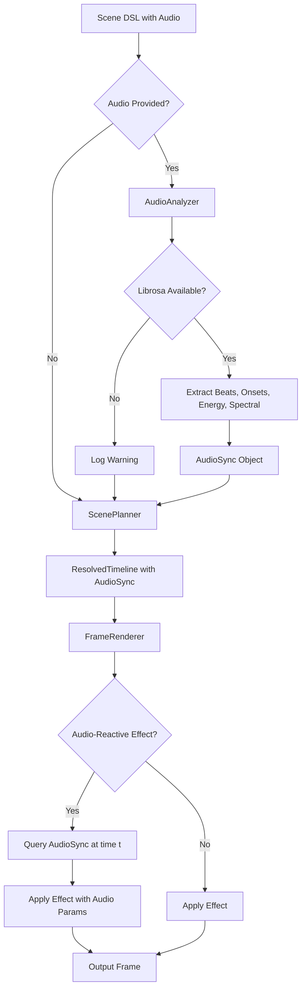

# Design Document: Video Engine Phase 3

## Overview

Phase 3 adds audio analysis and synchronization capabilities to the video engine, enabling audio-reactive visual effects. This phase integrates librosa to analyze TTS audio and extract temporal features (beats, onsets, energy) and spectral features (spectral centroid) that drive visual effects. The system enables videos where visual elements respond dynamically to narration audio—brightness pulses with loudness, transitions snap to beats, and color shifts with audio tone.

The architecture maintains Phase 1 and Phase 2's pure function approach. Audio analysis happens once during planning (not per-frame), and analysis results are passed as parameters to effects. The system degrades gracefully when audio is unavailable or librosa is not installed, ensuring backward compatibility.

### Key Design Principles

1. **Audio analysis is optional**: System works without audio; effects degrade gracefully
2. **Analyze once, query many**: Audio features computed during planning, interpolated at render time
3. **Pure functions preserved**: Effects remain stateless; audio data passed as parameters
4. **Backward compatible**: Existing scenes work unchanged; audio features are opt-in
5. **Graceful degradation**: Missing librosa or audio files don't crash the system

### Integration with Phases 1 and 2

Phase 3 extends four existing components:

- **Scene DSL**: Add optional `audio` attribute to Scene
- **ScenePlanner**: Analyze audio if provided, create AudioSync object
- **ResolvedTimeline**: Store AudioSync for renderer access
- **FrameRenderer**: Pass AudioSync to audio-reactive effects

All Phase 1 and Phase 2 functionality remains unchanged when audio is not provided.

## Architecture

### Component Diagram



### Data Flow with Audio Analysis

1. **Scene Definition**: User creates Scene with optional audio path
2. **Audio Analysis** (if audio provided):
   - Load audio with librosa
   - Detect beats using `librosa.beat.beat_track`
   - Detect onsets using `librosa.onset.onset_detect`
   - Compute energy envelope using `librosa.feature.rms`
   - Compute spectral centroid using `librosa.feature.spectral_centroid`
   - Convert all frame indices to timestamps
   - Create AudioSync object with interpolation support
3. **Planning**: ScenePlanner stores AudioSync in ResolvedTimeline
4. **Beat Sync** (if transitions use BeatSync):
   - Adjust transition start times to nearest beat
   - Ensure adjusted timings don't create negative durations
5. **Frame Rendering**: For each frame at time t:
   - Audio-reactive effects query AudioSync at time t
   - AudioSync interpolates between analysis frames
   - Effects apply modulation based on audio features
   - Non-audio-reactive effects work as in Phase 2
6. **Graceful Degradation**:
   - If librosa unavailable: log warning, skip audio analysis
   - If audio file missing: log error, skip audio analysis
   - If AudioSync is None: effects use default behavior (no modulation)

### Audio Analysis Timeline

```
Audio File: [0.0 ==================== 10.0s]
                ↓
Librosa Analysis (hop_length=512, sr=22050):
  - Beat timestamps: [0.5, 1.2, 1.9, 2.6, ...]
  - Onset timestamps: [0.1, 0.8, 1.5, 2.3, ...]
  - Energy envelope: [(0.0, 0.3), (0.023, 0.5), (0.046, 0.7), ...]
  - Spectral centroid: [(0.0, 1500), (0.023, 1800), (0.046, 1600), ...]
                ↓
AudioSync Object:
  - Stores all features with timestamps
  - Provides interpolation methods
  - get_energy_at_time(t) → interpolated energy
  - get_spectral_centroid_at_time(t) → interpolated centroid
  - get_nearest_beat(t) → closest beat timestamp
  - is_onset_active(t, duration) → bool
                ↓
Effects Query at Render Time:
  Frame at t=1.5s:
    - EnergyZoom queries energy at 1.5s → 0.65
    - Maps 0.65 to zoom scale 1.0-1.2 → 1.13
    - Applies zoom transform to frame
```

## Components and Interfaces

### Module Structure

```
engine/
├── __init__.py
├── scene.py           # Scene with audio attribute (UPDATED)
├── easing.py          # Easing functions (unchanged)
├── camera.py          # VirtualCamera, Rect (unchanged)
├── planner.py         # ScenePlanner with audio analysis (UPDATED)
├── renderer.py        # FrameRenderer (unchanged, effects handle audio)
├── image_loader.py    # ImageLoader (unchanged)
├── transitions.py     # Transition implementations (unchanged)
├── effects.py         # Effect implementations (UPDATED with audio-reactive effects)
└── audio/             # NEW: Audio analysis module
    ├── __init__.py
    ├── analyzer.py    # AudioAnalyzer class
    └── sync.py        # AudioSync class
```

### Updated Scene DSL (engine/scene.py)

```python
from dataclasses import dataclass, field
from pathlib import Path
from typing import Union, Optional

@dataclass
class Scene:
    """Defines a complete video scene with clips, transitions, and optional audio."""
    resolution: tuple[int, int] = (1920, 1080)
    fps: int = 30
    clips: list[ImageClip] = field(default_factory=list)
    transitions: list[Transition] = field(default_factory=list)
    audio: Optional[Union[str, Path]] = None  # NEW: Optional audio file for analysis
```

### BeatSync Enum (engine/scene.py)

```python
from enum import Enum

class BeatSync(Enum):
    """Controls how transitions align with audio beats."""
    NONE = "none"                    # Use declared timing (default)
    NEAREST_BEAT = "nearest_beat"    # Snap transition start to nearest beat
    BEAT_GRID = "beat_grid"          # Snap both start and end to beats
```

### Updated Transition (engine/scene.py)

```python
@dataclass
class Transition:
    """Defines a transition between two clips."""
    type: TransitionType
    duration: float  # seconds
    easing: EasingType = EasingType.EASE_IN_OUT_CUBIC
    sync: BeatSync = BeatSync.NONE  # NEW: Beat synchronization mode
```

### AudioAnalyzer (engine/audio/analyzer.py)

```python
from __future__ import annotations
from pathlib import Path
from typing import Optional
import numpy as np

class AudioAnalyzer:
    """Analyzes audio files using librosa to extract temporal and spectral features."""
    
    def __init__(self, audio_path: Union[str, Path]):
        """
        Initialize analyzer with audio file.
        
        Args:
            audio_path: Path to audio file (WAV, MP3, etc.)
            
        Raises:
            ImportError: If librosa is not installed
            FileNotFoundError: If audio file does not exist
            ValueError: If audio file format is unsupported
        """
        try:
            import librosa
        except ImportError:
            raise ImportError(
                "librosa is required for audio analysis. "
                "Install with: pip install librosa"
            )
        
        audio_path = Path(audio_path)
        if not audio_path.exists():
            raise FileNotFoundError(f"Audio file not found: {audio_path}")
        
        # Load audio
        self.y, self.sr = librosa.load(str(audio_path), sr=None)
        self.duration = len(self.y) / self.sr
        self._librosa = librosa
        
        # Cache for analysis results
        self._beats: Optional[np.ndarray] = None
        self._onsets: Optional[np.ndarray] = None
        self._energy: Optional[tuple[np.ndarray, np.ndarray]] = None
        self._spectral_centroid: Optional[tuple[np.ndarray, np.ndarray]] = None
    
    def analyze_beats(self) -> np.ndarray:
        """
        Detect beat timestamps using librosa.
        
        Returns:
            Array of beat timestamps in seconds
        """
        if self._beats is None:
            tempo, beat_frames = self._librosa.beat.beat_track(y=self.y, sr=self.sr)
            self._beats = self._librosa.frames_to_time(beat_frames, sr=self.sr)
        return self._beats
    
    def analyze_onsets(self) -> np.ndarray:
        """
        Detect onset timestamps using librosa.
        
        Returns:
            Array of onset timestamps in seconds
        """
        if self._onsets is None:
            onset_frames = self._librosa.onset.onset_detect(y=self.y, sr=self.sr)
            self._onsets = self._librosa.frames_to_time(onset_frames, sr=self.sr)
        return self._onsets
    
    def analyze_energy(self) -> tuple[np.ndarray, np.ndarray]:
        """
        Compute RMS energy envelope using librosa.
        
        Returns:
            Tuple of (timestamps, energy_values)
        """
        if self._energy is None:
            rms = self._librosa.feature.rms(y=self.y)[0]
            times = self._librosa.frames_to_time(
                np.arange(len(rms)), 
                sr=self.sr
            )
            self._energy = (times, rms)
        return self._energy
    
    def analyze_spectral_centroid(self) -> tuple[np.ndarray, np.ndarray]:
        """
        Compute spectral centroid using librosa.
        
        Returns:
            Tuple of (timestamps, centroid_values)
        """
        if self._spectral_centroid is None:
            centroid = self._librosa.feature.spectral_centroid(y=self.y, sr=self.sr)[0]
            times = self._librosa.frames_to_time(
                np.arange(len(centroid)), 
                sr=self.sr
            )
            self._spectral_centroid = (times, centroid)
        return self._spectral_centroid
    
    def analyze_all(self) -> dict:
        """
        Run all analyses and return results.
        
        Returns:
            Dictionary with keys: beats, onsets, energy, spectral_centroid
        """
        return {
            'beats': self.analyze_beats(),
            'onsets': self.analyze_onsets(),
            'energy': self.analyze_energy(),
            'spectral_centroid': self.analyze_spectral_centroid()
        }
```

### AudioSync (engine/audio/sync.py)

```python
from __future__ import annotations
from typing import Optional
import numpy as np

class AudioSync:
    """Maps audio features to video timeline with interpolation support."""
    
    def __init__(
        self,
        beats: np.ndarray,
        onsets: np.ndarray,
        energy_times: np.ndarray,
        energy_values: np.ndarray,
        spectral_times: np.ndarray,
        spectral_values: np.ndarray
    ):
        """
        Initialize with audio analysis results.
        
        Args:
            beats: Array of beat timestamps
            onsets: Array of onset timestamps
            energy_times: Timestamps for energy envelope
            energy_values: Energy values (RMS)
            spectral_times: Timestamps for spectral centroid
            spectral_values: Spectral centroid values
        """
        self.beats = beats
        self.onsets = onsets
        self.energy_times = energy_times
        self.energy_values = energy_values
        self.spectral_times = spectral_times
        self.spectral_values = spectral_values
    
    def get_energy_at_time(self, t: float) -> float:
        """
        Get interpolated energy at time t.
        
        Args:
            t: Time in seconds
            
        Returns:
            Interpolated energy value (0.0 if no data)
        """
        if len(self.energy_times) == 0:
            return 0.0
        
        # Handle edge cases
        if t <= self.energy_times[0]:
            return float(self.energy_values[0])
        if t >= self.energy_times[-1]:
            return float(self.energy_values[-1])
        
        # Linear interpolation
        return float(np.interp(t, self.energy_times, self.energy_values))
    
    def get_spectral_centroid_at_time(self, t: float) -> float:
        """
        Get interpolated spectral centroid at time t.
        
        Args:
            t: Time in seconds
            
        Returns:
            Interpolated spectral centroid (0.0 if no data)
        """
        if len(self.spectral_times) == 0:
            return 0.0
        
        # Handle edge cases
        if t <= self.spectral_times[0]:
            return float(self.spectral_values[0])
        if t >= self.spectral_times[-1]:
            return float(self.spectral_values[-1])
        
        # Linear interpolation
        return float(np.interp(t, self.spectral_times, self.spectral_values))
    
    def get_nearest_beat(self, t: float) -> Optional[float]:
        """
        Get timestamp of nearest beat to time t.
        
        Args:
            t: Time in seconds
            
        Returns:
            Nearest beat timestamp, or None if no beats
        """
        if len(self.beats) == 0:
            return None
        
        idx = np.argmin(np.abs(self.beats - t))
        return float(self.beats[idx])
    
    def is_onset_active(self, t: float, duration: float) -> bool:
        """
        Check if any onset is within duration of time t.
        
        Args:
            t: Time in seconds
            duration: Window duration in seconds
            
        Returns:
            True if onset is active, False otherwise
        """
        if len(self.onsets) == 0:
            return False
        
        # Check if any onset is within [t, t + duration]
        return np.any((self.onsets >= t) & (self.onsets <= t + duration))
    
    def get_closest_onset(self, t: float, max_distance: float) -> Optional[float]:
        """
        Get closest onset within max_distance of time t.
        
        Args:
            t: Time in seconds
            max_distance: Maximum distance in seconds
            
        Returns:
            Closest onset timestamp, or None if none within range
        """
        if len(self.onsets) == 0:
            return None
        
        distances = np.abs(self.onsets - t)
        min_idx = np.argmin(distances)
        
        if distances[min_idx] <= max_distance:
            return float(self.onsets[min_idx])
        return None
```

### Updated ScenePlanner (engine/planner.py)

```python
# Add to existing ScenePlanner class

def _analyze_audio(self, scene: Scene) -> Optional[AudioSync]:
    """
    Analyze audio if provided in scene.
    
    Args:
        scene: Scene with optional audio attribute
        
    Returns:
        AudioSync object if analysis succeeds, None otherwise
    """
    if scene.audio is None:
        return None
    
    try:
        from engine.audio.analyzer import AudioAnalyzer
        from engine.audio.sync import AudioSync
        
        # Analyze audio
        analyzer = AudioAnalyzer(scene.audio)
        results = analyzer.analyze_all()
        
        # Create AudioSync object
        energy_times, energy_values = results['energy']
        spectral_times, spectral_values = results['spectral_centroid']
        
        audio_sync = AudioSync(
            beats=results['beats'],
            onsets=results['onsets'],
            energy_times=energy_times,
            energy_values=energy_values,
            spectral_times=spectral_times,
            spectral_values=spectral_values
        )
        
        return audio_sync
        
    except ImportError as e:
        import logging
        logging.warning(f"Audio analysis disabled: {e}")
        return None
    except Exception as e:
        import logging
        logging.error(f"Audio analysis failed: {e}")
        return None

def _apply_beat_sync(
    self, 
    transitions: list[Transition], 
    clip_timings: list[tuple[float, float]],
    audio_sync: Optional[AudioSync]
) -> list[tuple[float, float]]:
    """
    Adjust transition timings based on beat sync settings.
    
    Args:
        transitions: List of transitions
        clip_timings: List of (start, end) tuples for each clip
        audio_sync: AudioSync object or None
        
    Returns:
        Adjusted clip timings accounting for beat-synced transitions
    """
    if audio_sync is None or len(audio_sync.beats) == 0:
        return clip_timings
    
    # Implementation adjusts transition start times to nearest beats
    # while ensuring no negative durations or invalid overlaps
    # Details in implementation phase
    ...
```

### Updated ResolvedTimeline (engine/planner.py)

```python
@dataclass
class ResolvedTimeline:
    """Timeline with resolved clip timings, camera paths, and audio sync."""
    clips: list[ResolvedClip]
    transitions: list[ResolvedTransition]
    total_duration: float
    audio_sync: Optional[AudioSync] = None  # NEW: Audio synchronization data
```

## Data Models

### Audio Analysis Results

```python
# Stored in AudioSync object

beats: np.ndarray
# Shape: (n_beats,)
# Example: [0.5, 1.2, 1.9, 2.6, 3.3, ...]
# Units: seconds

onsets: np.ndarray
# Shape: (n_onsets,)
# Example: [0.1, 0.8, 1.5, 2.3, 3.1, ...]
# Units: seconds

energy_times: np.ndarray
# Shape: (n_frames,)
# Example: [0.0, 0.023, 0.046, 0.069, ...]
# Units: seconds

energy_values: np.ndarray
# Shape: (n_frames,)
# Example: [0.3, 0.5, 0.7, 0.6, 0.4, ...]
# Units: normalized RMS energy (0.0-1.0 typical range)

spectral_times: np.ndarray
# Shape: (n_frames,)
# Example: [0.0, 0.023, 0.046, 0.069, ...]
# Units: seconds

spectral_values: np.ndarray
# Shape: (n_frames,)
# Example: [1500, 1800, 1600, 1400, ...]
# Units: Hz (spectral centroid frequency)
```

### Audio-Reactive Effect Parameters

```python
# Example: EnergyZoom effect

@dataclass
class EnergyZoomParams:
    """Parameters for energy-driven zoom effect."""
    audio_sync: Optional[AudioSync]
    zoom_range: tuple[float, float] = (1.0, 1.2)  # (min_zoom, max_zoom)
    energy_range: tuple[float, float] = (0.0, 1.0)  # (min_energy, max_energy)
    
    def get_zoom_at_time(self, t: float) -> float:
        """Compute zoom scale at time t based on audio energy."""
        if self.audio_sync is None:
            return 1.0  # No zoom when no audio
        
        energy = self.audio_sync.get_energy_at_time(t)
        
        # Map energy to zoom range
        energy_normalized = (energy - self.energy_range[0]) / (
            self.energy_range[1] - self.energy_range[0]
        )
        energy_normalized = np.clip(energy_normalized, 0.0, 1.0)
        
        zoom = self.zoom_range[0] + energy_normalized * (
            self.zoom_range[1] - self.zoom_range[0]
        )
        return zoom
```


## Correctness Properties

A property is a characteristic or behavior that should hold true across all valid executions of a system—essentially, a formal statement about what the system should do. Properties serve as the bridge between human-readable specifications and machine-verifiable correctness guarantees.

### Property 1: Audio Loading Produces Valid Data

*For any* valid audio file, when AudioAnalyzer loads the audio, the resulting sample rate should be positive and the audio samples should be a non-empty numpy array.

**Validates: Requirements 1.2, 1.3**

### Property 2: Analysis Methods Return Timestamp Arrays

*For any* valid audio file, when any analysis method (beats, onsets, energy, spectral_centroid) is called, the returned timestamps should be monotonically increasing arrays in seconds.

**Validates: Requirements 1.4, 1.5, 1.6, 1.7, 1.8**

### Property 3: Beat Sync NONE Preserves Timing

*For any* scene with transitions using sync=NONE, the planned transition timings should exactly match the declared timings regardless of audio content.

**Validates: Requirements 2.6**

### Property 4: Beat Sync NEAREST_BEAT Snaps to Beats

*For any* scene with audio and transitions using sync=NEAREST_BEAT, each transition start time should be within half a beat interval of a detected beat timestamp.

**Validates: Requirements 2.4**

### Property 5: Beat Sync BEAT_GRID Snaps Both Boundaries

*For any* scene with audio and transitions using sync=BEAT_GRID, both the transition start and end times should align with beat timestamps.

**Validates: Requirements 2.5**

### Property 6: Beat Sync Without Audio Falls Back

*For any* scene without audio, all BeatSync settings should be ignored and transitions should use declared timings.

**Validates: Requirements 2.7**

### Property 7: Beat Snapping Preserves Valid Durations

*For any* scene with beat-synced transitions, after beat snapping, all transition durations should remain positive and no clip durations should become negative.

**Validates: Requirements 2.9**

### Property 8: OnsetFlash Only Modifies During Onset Windows

*For any* frame and time t, OnsetFlash should return the frame unchanged if and only if no onset is within flash_duration of t.

**Validates: Requirements 3.3, 3.5**

### Property 9: OnsetFlash Brightness Increases During Onset

*For any* frame at time t during an onset window, OnsetFlash should increase the frame's average brightness compared to the input frame.

**Validates: Requirements 3.4**

### Property 10: OnsetFlash Uses Easing for Decay

*For any* onset event, the brightness increase should follow the specified easing curve from maximum at onset time to zero at onset time + flash_duration.

**Validates: Requirements 3.6**

### Property 11: OnsetFlash Maximum for Overlapping Onsets

*For any* time t with multiple active onsets, OnsetFlash should apply the maximum flash intensity among all active onsets.

**Validates: Requirements 3.7**

### Property 12: OnsetZoomPulse Only Modifies During Onset Windows

*For any* frame and time t, OnsetZoomPulse should return the frame unchanged if and only if no onset is within pulse_duration of t.

**Validates: Requirements 4.3, 4.5**

### Property 13: OnsetZoomPulse Scales Frame During Onset

*For any* frame at time t during an onset window, OnsetZoomPulse should scale the frame by a factor greater than 1.0.

**Validates: Requirements 4.4**

### Property 14: OnsetZoomPulse Uses Easing for Timing

*For any* onset event, the zoom scale should follow the specified easing curve from maximum at onset time to 1.0 at onset time + pulse_duration.

**Validates: Requirements 4.6**

### Property 15: EnergyZoom Maps Energy to Zoom Range

*For any* frame at time t with audio sync, EnergyZoom should map the interpolated energy value to a zoom scale within the specified zoom_range.

**Validates: Requirements 5.3, 5.4, 5.5**

### Property 16: EnergyBrightness Maps Energy to Brightness Range

*For any* frame at time t with audio sync, EnergyBrightness should map the interpolated energy value to a brightness multiplier within the specified brightness_range.

**Validates: Requirements 6.3, 6.4, 6.5**

### Property 17: EnergyShake Maps Energy to Shake Range

*For any* frame at time t with audio sync, EnergyShake should map the interpolated energy value to a shake displacement within the specified shake_range.

**Validates: Requirements 7.3, 7.4**

### Property 18: SpectralColorShift Maps Centroid to Temperature

*For any* frame at time t with audio sync, SpectralColorShift should map the interpolated spectral centroid to a color temperature shift within the specified temperature_range.

**Validates: Requirements 8.3, 8.4, 8.5**

### Property 19: Audio-Reactive Effects Degrade Gracefully

*For any* audio-reactive effect (EnergyZoom, EnergyBrightness, EnergyShake, SpectralColorShift), when AudioSync is None or energy envelope is empty, the effect should return the frame unchanged.

**Validates: Requirements 5.7, 6.7, 7.7, 8.7**

### Property 20: AudioSync Stores All Analysis Results

*For any* AudioAnalyzer results, when AudioSync is initialized, all beats, onsets, energy data, and spectral data should be accessible through the AudioSync object.

**Validates: Requirements 9.2**

### Property 21: AudioSync Interpolates Time-Series Data

*For any* time t between two analysis frames, AudioSync interpolation methods (get_energy_at_time, get_spectral_centroid_at_time) should return values between the two neighboring frame values.

**Validates: Requirements 9.3, 9.4**

### Property 22: AudioSync Finds Nearest Beat

*For any* time t and beat array, get_nearest_beat should return the beat timestamp with minimum absolute distance to t.

**Validates: Requirements 9.5**

### Property 23: AudioSync Detects Onset Windows

*For any* time t, duration d, and onset array, is_onset_active should return True if and only if at least one onset timestamp falls in the interval [t, t+d].

**Validates: Requirements 9.6**

### Property 24: Scene with Audio Triggers Analysis

*For any* scene with a valid audio path, ScenePlanner should create an AudioSync object and store it in the ResolvedTimeline.

**Validates: Requirements 10.2, 10.3**

### Property 25: Scene without Audio Skips Analysis

*For any* scene with audio=None, ScenePlanner should create a ResolvedTimeline with audio_sync=None.

**Validates: Requirements 10.5**

### Property 26: Effects Query AudioSync at Render Time

*For any* audio-reactive effect, when rendering a frame at time t, the effect should query AudioSync at time t to obtain audio features.

**Validates: Requirements 11.4**

## Error Handling

### Librosa Import Errors

When librosa is not installed:
- AudioAnalyzer.__init__ raises ImportError with message: "librosa is required for audio analysis. Install with: pip install librosa"
- ScenePlanner logs warning and continues without audio analysis
- All audio-reactive effects degrade gracefully (no modulation)

### Audio File Errors

When audio file does not exist:
- AudioAnalyzer.__init__ raises FileNotFoundError with the file path
- ScenePlanner logs error and continues without audio analysis

When audio file format is unsupported:
- librosa.load raises ValueError
- ScenePlanner catches exception, logs error, continues without audio analysis

### Analysis Failures

When beat detection fails:
- ScenePlanner logs warning: "Beat detection failed for {audio_path}, using declared timings"
- BeatSync settings are ignored, declared timings used

When onset detection fails:
- ScenePlanner logs warning: "Onset detection failed for {audio_path}, onset effects disabled"
- Onset effects return frames unchanged

When energy analysis fails:
- ScenePlanner logs warning: "Energy analysis failed for {audio_path}, energy effects disabled"
- Energy-driven effects return frames unchanged

### Beat Sync Edge Cases

When beat-snapped transition would create negative duration:
- ScenePlanner logs warning and uses nearest valid beat that preserves positive duration
- If no valid beat exists, falls back to declared timing

When beat-snapped transition would create clip overlap:
- ScenePlanner adjusts to nearest beat that avoids overlap
- If no valid beat exists, falls back to declared timing

### AudioSync Edge Cases

When querying time before first analysis frame:
- Return value of first frame (no extrapolation)

When querying time after last analysis frame:
- Return value of last frame (no extrapolation)

When energy envelope is empty:
- get_energy_at_time returns 0.0
- Energy-driven effects apply no modulation

When no beats detected:
- get_nearest_beat returns None
- BeatSync falls back to declared timings

When no onsets detected:
- is_onset_active always returns False
- Onset effects apply no modulation

## Testing Strategy

### Unit Tests

**AudioAnalyzer Tests**:
- Test loading various audio formats (WAV, MP3, OGG)
- Test beat detection with synthetic audio (known beat pattern)
- Test onset detection with synthetic audio (known transients)
- Test energy analysis returns correct shape and range
- Test spectral centroid analysis returns correct shape and range
- Test frame-to-time conversion produces monotonic timestamps
- Test error handling for missing librosa
- Test error handling for invalid audio files

**AudioSync Tests**:
- Test initialization stores all data correctly
- Test get_energy_at_time interpolation with known values
- Test get_spectral_centroid_at_time interpolation with known values
- Test get_nearest_beat with known beat array
- Test is_onset_active with known onset array
- Test edge cases (before first frame, after last frame)
- Test empty data returns default values

**Beat Sync Tests**:
- Test NONE mode preserves declared timings
- Test NEAREST_BEAT snaps to closest beat
- Test BEAT_GRID snaps both boundaries
- Test beat sync without audio uses declared timings
- Test beat sync preserves positive durations
- Test beat sync avoids negative clip durations

**Audio-Reactive Effect Tests**:
- Test OnsetFlash brightens during onset window
- Test OnsetFlash unchanged outside onset window
- Test OnsetFlash uses easing curve
- Test OnsetFlash maximum for overlapping onsets
- Test OnsetZoomPulse scales during onset window
- Test OnsetZoomPulse unchanged outside onset window
- Test EnergyZoom maps energy to zoom range
- Test EnergyBrightness maps energy to brightness range
- Test EnergyShake maps energy to shake range
- Test SpectralColorShift maps centroid to temperature
- Test all effects degrade gracefully without audio

### Property-Based Tests

Each property test should run minimum 100 iterations with randomized inputs.

**Property 1: Audio Loading Produces Valid Data**
- Generate: Random valid audio files (synthetic sine waves, noise)
- Test: Load audio, verify sr > 0 and len(samples) > 0
- Tag: Feature: video-engine-phase-3, Property 1

**Property 2: Analysis Methods Return Timestamp Arrays**
- Generate: Random valid audio files
- Test: Call all analysis methods, verify timestamps are monotonic and in seconds
- Tag: Feature: video-engine-phase-3, Property 2

**Property 3: Beat Sync NONE Preserves Timing**
- Generate: Random scenes with transitions using sync=NONE
- Test: Plan timeline, verify transition times match declared times
- Tag: Feature: video-engine-phase-3, Property 3

**Property 4: Beat Sync NEAREST_BEAT Snaps to Beats**
- Generate: Random scenes with audio and NEAREST_BEAT transitions
- Test: Plan timeline, verify each transition start is near a beat
- Tag: Feature: video-engine-phase-3, Property 4

**Property 5: Beat Sync BEAT_GRID Snaps Both Boundaries**
- Generate: Random scenes with audio and BEAT_GRID transitions
- Test: Plan timeline, verify both start and end align with beats
- Tag: Feature: video-engine-phase-3, Property 5

**Property 6: Beat Sync Without Audio Falls Back**
- Generate: Random scenes without audio, various BeatSync settings
- Test: Plan timeline, verify declared timings used
- Tag: Feature: video-engine-phase-3, Property 6

**Property 7: Beat Snapping Preserves Valid Durations**
- Generate: Random scenes with beat-synced transitions
- Test: Plan timeline, verify all durations are positive
- Tag: Feature: video-engine-phase-3, Property 7

**Property 8: OnsetFlash Only Modifies During Onset Windows**
- Generate: Random frames, times, onset arrays, flash durations
- Test: Apply OnsetFlash, verify unchanged iff no onset in window
- Tag: Feature: video-engine-phase-3, Property 8

**Property 9: OnsetFlash Brightness Increases During Onset**
- Generate: Random frames, times during onset windows
- Test: Apply OnsetFlash, verify average brightness increases
- Tag: Feature: video-engine-phase-3, Property 9

**Property 10: OnsetFlash Uses Easing for Decay**
- Generate: Random onset times, flash durations, easing functions
- Test: Sample brightness at multiple times, verify follows easing curve
- Tag: Feature: video-engine-phase-3, Property 10

**Property 11: OnsetFlash Maximum for Overlapping Onsets**
- Generate: Random frames with overlapping onset windows
- Test: Apply OnsetFlash, verify intensity is maximum of all active onsets
- Tag: Feature: video-engine-phase-3, Property 11

**Property 12-14: OnsetZoomPulse Properties**
- Similar to OnsetFlash properties, testing zoom instead of brightness
- Tags: Feature: video-engine-phase-3, Property 12/13/14

**Property 15: EnergyZoom Maps Energy to Zoom Range**
- Generate: Random frames, times, energy envelopes, zoom ranges
- Test: Apply EnergyZoom, verify zoom scale is within range
- Tag: Feature: video-engine-phase-3, Property 15

**Property 16: EnergyBrightness Maps Energy to Brightness Range**
- Generate: Random frames, times, energy envelopes, brightness ranges
- Test: Apply EnergyBrightness, verify brightness multiplier is within range
- Tag: Feature: video-engine-phase-3, Property 16

**Property 17: EnergyShake Maps Energy to Shake Range**
- Generate: Random frames, times, energy envelopes, shake ranges
- Test: Apply EnergyShake, verify shake displacement is within range
- Tag: Feature: video-engine-phase-3, Property 17

**Property 18: SpectralColorShift Maps Centroid to Temperature**
- Generate: Random frames, times, spectral centroids, temperature ranges
- Test: Apply SpectralColorShift, verify temperature shift is within range
- Tag: Feature: video-engine-phase-3, Property 18

**Property 19: Audio-Reactive Effects Degrade Gracefully**
- Generate: Random frames, all audio-reactive effects, None AudioSync
- Test: Apply effects, verify frames unchanged
- Tag: Feature: video-engine-phase-3, Property 19

**Property 20: AudioSync Stores All Analysis Results**
- Generate: Random audio analysis results
- Test: Initialize AudioSync, verify all data accessible
- Tag: Feature: video-engine-phase-3, Property 20

**Property 21: AudioSync Interpolates Time-Series Data**
- Generate: Random time-series data, query times between frames
- Test: Query AudioSync, verify interpolated values are between neighbors
- Tag: Feature: video-engine-phase-3, Property 21

**Property 22: AudioSync Finds Nearest Beat**
- Generate: Random beat arrays, query times
- Test: Call get_nearest_beat, verify returned beat is closest
- Tag: Feature: video-engine-phase-3, Property 22

**Property 23: AudioSync Detects Onset Windows**
- Generate: Random onset arrays, query times, durations
- Test: Call is_onset_active, verify True iff onset in window
- Tag: Feature: video-engine-phase-3, Property 23

**Property 24: Scene with Audio Triggers Analysis**
- Generate: Random scenes with valid audio paths
- Test: Plan scene, verify AudioSync is not None in timeline
- Tag: Feature: video-engine-phase-3, Property 24

**Property 25: Scene without Audio Skips Analysis**
- Generate: Random scenes with audio=None
- Test: Plan scene, verify AudioSync is None in timeline
- Tag: Feature: video-engine-phase-3, Property 25

**Property 26: Effects Query AudioSync at Render Time**
- Generate: Random audio-reactive effects, times, AudioSync objects
- Test: Render frame, verify effect queries AudioSync at correct time
- Tag: Feature: video-engine-phase-3, Property 26

### Integration Tests

**End-to-End with Audio**:
- Create scene with audio file, clips, transitions with BeatSync
- Add audio-reactive effects to clips
- Plan and render complete video
- Verify video renders without errors
- Verify transitions align with beats (visual inspection or frame analysis)
- Verify effects respond to audio (brightness changes with energy)

**Graceful Degradation**:
- Create scene with audio but librosa not installed
- Verify system logs warning and continues
- Verify video renders with declared timings and no audio effects

**Error Recovery**:
- Create scene with invalid audio path
- Verify system logs error and continues
- Verify video renders without audio features

### Performance Tests

**Audio Analysis Time**:
- Measure time to analyze 10-second audio file
- Verify analysis completes in < 1 second (< 10% of audio duration)

**Render Time with Audio Effects**:
- Measure time to render 100 frames with audio-reactive effects
- Compare to baseline (no audio effects)
- Verify overhead is < 20% (audio queries are fast)

**Memory Usage**:
- Monitor memory during audio analysis
- Verify peak memory < 100MB for typical audio files
- Verify AudioSync object size is reasonable (< 1MB for 10s audio)

